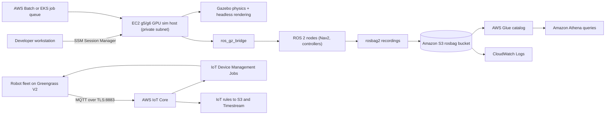
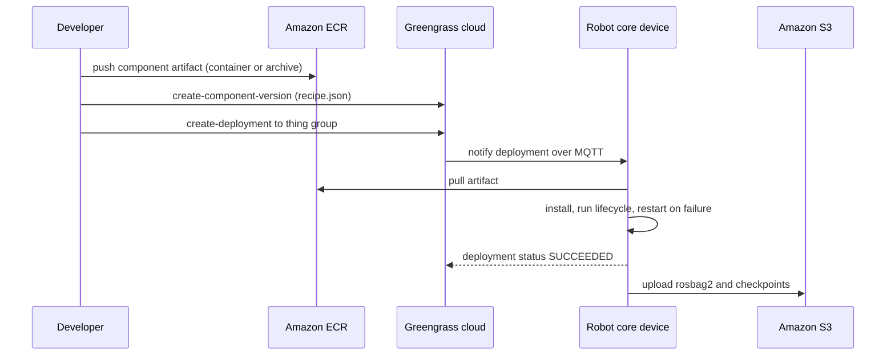
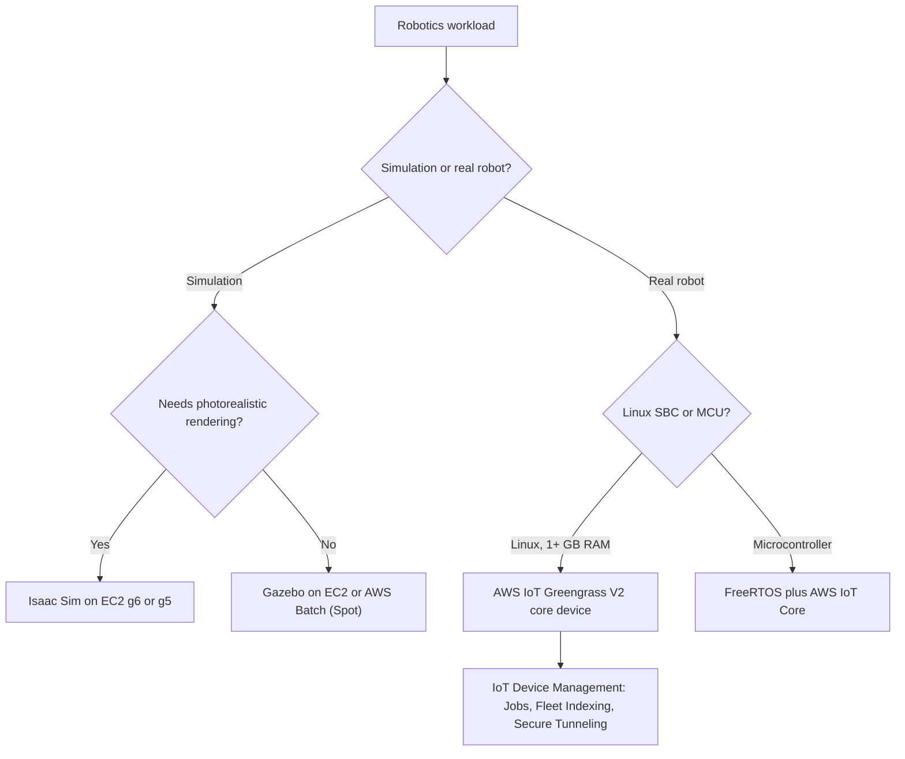

# 02 · Robotics on AWS

> **Phase 9 — Cutting-Edge AWS** · Lesson 02 of 06
> ⬅️ Previous: [Amazon Braket](./01-amazon-braket.md) · ➡️ Next: [AWS Ground Station](./03-aws-ground-station.md) · 🏠 [Phase overview](./README.md)

## 🎯 Learning Objectives

By the end of this lesson you will be able to:

- Explain what AWS RoboMaker did, why it no longer exists, and what replaced it
- Describe ROS 2 fundamentals — nodes, topics, services, actions, and DDS — well enough to design a cloud simulation
- Run a headless Gazebo simulation on Amazon EC2 and capture the results as `rosbag2` files in Amazon S3
- Manage a robot fleet with AWS IoT Greengrass V2, AWS IoT Device Management, and AWS IoT Core

**Estimated time:** 80 min · **Difficulty:** Intermediate

---

## 🧠 Core Concepts

### What AWS RoboMaker was

AWS RoboMaker launched in 2018 as a managed robotics development service with three parts: a cloud IDE for writing ROS code, a managed **simulation** service that ran Gazebo on AWS-managed infrastructure for parallel scenario testing, and **fleet management** built on Greengrass v1 for deploying applications and collecting logs from robots in the field. It solved a genuine problem: simulating thousands of robot-hours requires more compute than any robotics team has on its desks.

**AWS RoboMaker reached end of support on 30 September 2025 and is closed to new customers.** The console and the service documentation are no longer available, and the service is not an option for new workloads. If you find a tutorial that starts with "create a RoboMaker simulation job", it is out of date.

### What replaced it

There was no single successor service. Instead, the three RoboMaker capabilities were pushed down onto general-purpose services:

| RoboMaker capability | Current approach |
|----------------------|------------------|
| Managed Gazebo simulation | Run `gz sim` (Gazebo) yourself on EC2 GPU instances, AWS Batch, or Amazon EKS with Karpenter |
| Cloud IDE for ROS | Local VS Code, or an EC2 dev instance reached through AWS Systems Manager Session Manager |
| Fleet management (Greengrass v1) | AWS IoT Greengrass V2 components and deployments |
| App deployment to robots | AWS IoT Device Management Jobs, with Greengrass V2 artifact deployment |
| Log collection | `rosbag2` upload to Amazon S3, CloudWatch Logs via the Greengrass log manager, AWS IoT FleetWise for vehicle telemetry |
| Fleet queries | AWS IoT Device Management Fleet Indexing across thing groups and attributes |

This is not a downgrade. Running Gazebo on EC2 gives you instance-type control, Spot pricing, and container packaging that the managed service never exposed — but it also means you own the AMI, the GPU drivers, the DDS configuration, and the cleanup.

### ROS 2 in one page

ROS 2 is not a framework you call; it is a set of conventions plus a middleware. A **node** is a process. Nodes exchange **messages** over typed **topics** (many-to-many, streaming), call **services** (request/response, blocking), or invoke **actions** (long-running, cancellable, with feedback). The plumbing is DDS — Data Distribution Service — which handles discovery, QoS, and transport. ROS 2 defaults to eProsima Fast DDS but Cyclone DDS and others are interchangeable, and that choice has real consequences in the cloud where multicast and discovery are restricted.

Sensors publish to topics: `/scan` (LaserScan), `/camera/image_raw`, `/odom` (Odometry). Control goes the other way: a velocity command to `/cmd_vel` as `geometry_msgs/msg/Twist`. Transforms between coordinate frames are published as `/tf` and `/tf_static` and consumed by `tf2`. Robot descriptions are URDF or SDF. Navigation is Nav2, motion planning is MoveIt 2.

Two nodes on the same **ROS_DOMAIN_ID** will discover each other over multicast. In a VPC that is often blocked, so cloud simulations either run everything on one host, or configure a unicast discovery server / `ROS_STATIC_PEERS`. This is the single most common reason a cloud simulation "works locally but not on EC2".

### Simulation in the cloud

Gazebo (the simulator formerly known as Ignition) runs in two pieces: a physics server (`gz sim -s`) and a GUI (`gz sim -g`). On a cloud host you run the server headless, optionally with `--headless-rendering` so camera sensors still produce images through EGL or OGRE 2 without a display server. The `ros_gz_bridge` package bridges Gazebo topics to ROS 2 topics, which is how your ROS 2 nodes see a simulated robot as if it were real.

Parallel scenario testing is the reason to go to the cloud: one container image, one scenario parameter, N parallel Batch jobs, and a results table. NVIDIA Isaac Sim on EC2 is the other common choice when you need photorealistic rendering or synthetic dataset generation for perception models.

---

## 🗺️ Architecture Diagram

A cloud robotics stack, end to end — simulation in the cloud, robot fleet in the field:



Deployment of a new robotics application, from your laptop to the fleet:



Deciding where each piece runs:



---

## 🧪 Hands-on Lab: Simulate a Robot in the Cloud Without RoboMaker

**Goal:** Launch a GPU EC2 instance, run ROS 2 Jazzy with headless Gazebo, drive the simulated robot, record a `rosbag2`, ship it to S3, and then wire the same pattern into a Greengrass V2 component.

**Prerequisites:**

- An AWS account with the AWS CLI v2 configured
- Permission to launch EC2 instances, create IAM instance profiles, and write to S3
- An existing VPC with a private subnet and an interface VPC endpoint for Systems Manager (so you never open SSH to the internet)
- Approximately 40 GB of free space on disk and acceptance of GPU instance quota

### Step 1 — Launch the simulation host with no inbound ports

```bash
# Create a role that lets the instance read simulation input and write results, plus SSM access
aws iam create-role \
  --role-name RobotSimHostRole \
  --assume-role-policy-document '{"Version":"2012-10-17","Statement":[{"Effect":"Allow","Principal":{"Service":"ec2.amazonaws.com"},"Action":"sts:AssumeRole"}]}'

aws iam attach-role-policy --role-name RobotSimHostRole \
  --policy-arn arn:aws:iam::aws:policy/AmazonSSMManagedInstanceCore
aws iam attach-role-policy --role-name RobotSimHostRole \
  --policy-arn arn:aws:iam::aws:policy/AmazonS3ReadOnlyAccess
aws iam create-instance-profile --instance-profile-name RobotSimHostProfile
aws iam add-role-to-instance-profile \
  --instance-profile-name RobotSimHostProfile --role-name RobotSimHostRole

# Launch a GPU instance in a private subnet with no public IP
aws ec2 run-instances \
  --image-id ami-0123456789abcdef0 \
  --instance-type g5.xlarge \
  --iam-instance-profile Name=RobotSimHostProfile \
  --subnet-id subnet-0abc123def4567890 \
  --no-associate-public-ip-address \
  --block-device-mappings '[{"DeviceName":"/dev/xvda","Ebs":{"VolumeSize":100,"VolumeType":"gp3","DeleteOnTermination":true}}]' \
  --tag-specifications 'ResourceType=instance,Tags=[{Key=Name,Value=robot-sim-host}]'

# Open a shell without SSH or a bastion
aws ssm start-session --target i-0123456789abcdef0
```

### Step 2 — Install ROS 2 Jazzy and Gazebo (Harmonic)

```bash
# On Ubuntu 24.04 on the sim host
sudo apt update && sudo apt install -y curl gnupg lsb-release
sudo curl -sSL https://raw.githubusercontent.com/ros/rosdistro/master/ros.key \
  -o /usr/share/keyrings/ros-archive-keyring.gpg
echo "deb [arch=amd64 signed-by=/usr/share/keyrings/ros-archive-keyring.gpg] http://packages.ros.org/ros2/ubuntu $(lsb_release -cs) main" \
  | sudo tee /etc/apt/sources.list.d/ros2.list

# ros-jazzy-ros-gz brings Gazebo Harmonic and the ROS 2 bridge in one package
sudo apt update && sudo apt install -y ros-jazzy-desktop ros-jazzy-ros-gz ros-jazzy-nav2-bringup
source /opt/ros/jazzy/setup.bash
```

### Step 3 — Run Gazebo headless and bridge it to ROS 2

```bash
# Physics server only: no GUI, but camera sensors still render
gz sim -s -r --headless-rendering -v 4 empty.sdf

# In a second session on the same host, bridge Gazebo topics into ROS 2
source /opt/ros/jazzy/setup.bash
ros2 run ros_gz_bridge parameter_bridge \
  /cmd_vel@geometry_msgs/msg/Twist@gz.msgs.Twist \
  /scan@sensor_msgs/msg/LaserScan@gz.msgs.LaserScan \
  /tf@tf2_msgs/msg/TFMessage@gz.msgs.Pose_V

# Confirm the simulated robot is visible as ordinary ROS 2 topics
ros2 topic list
ros2 topic echo /scan --once
```

### Step 4 — Drive the robot and record a bag

```bash
# Publish a velocity command: 0.2 m/s forward, 0.5 rad/s turn
ros2 topic pub -r 10 /cmd_vel geometry_msgs/msg/Twist \
  "{linear: {x: 0.2}, angular: {z: 0.5}}" &

# Record every topic into a rosbag2, then stop after 30 seconds
ros2 bag record -a -o run-001 --max-cache-size 100000000
sleep 30 && kill %1

# Inspect and then upload
ros2 bag info run-001
aws s3 cp run-001 s3://robot-logs-123456789012/sim/run-001/ --recursive --sse aws:kms
```

### Step 5 — Package the same pattern as a Greengrass V2 component

```json
{
  "RecipeFormatVersion": "2020-01-25",
  "ComponentName": "com.example.RobotLogUploader",
  "ComponentVersion": "1.0.0",
  "ComponentDescription": "Uploads rosbag2 recordings and robot health to AWS",
  "ComponentPublisher": "Example Robotics",
  "ComponentConfiguration": {
    "DefaultConfiguration": {
      "uploadIntervalSeconds": 300,
      "accessControl": {
        "aws.greengrass.ipc.mqttproxy": {
          "com.example.RobotLogUploader:mqtt:1": {
            "operations": ["aws.greengrass#PublishToIoTCore"],
            "resources": ["robots/+/telemetry"]
          }
        }
      }
    }
  },
  "Manifests": [
    {
      "Platform": { "os": "linux" },
      "Lifecycle": { "Run": "python3 -u {artifacts:path}/uploader.py" },
      "Artifacts": [{ "URI": "s3://robot-artifacts-123456789012/uploader/1.0.0/uploader.py" }]
    }
  ]
}
```

```bash
# Publish the component, then deploy it to the whole fleet via a thing group
aws greengrassv2 create-component-version --inline-recipe fileb://recipe.json

aws greengrassv2 create-deployment \
  --target-arn arn:aws:iot:eu-west-1:123456789012:thinggroup/warehouse-robots \
  --deployment-name roll-out-log-uploader-1.0.0 \
  --components '{"com.example.RobotLogUploader":{"componentVersion":"1.0.0"}}' \
  --deployment-policies '{"failureHandlingPolicy":"ROLLBACK","componentUpdatePolicy":{"action":"NOTIFY_COMPONENTS","timeoutInSeconds":60}}'
```

### Step 6 — Verify

```bash
# Check that the deployment reached the group and see per-device status
aws greengrassv2 list-deployments --target-arn arn:aws:iot:eu-west-1:123456789012:thinggroup/warehouse-robots
aws greengrassv2 get-deployment --deployment-id <deployment-id>

# Query fleet state with Fleet Indexing
aws iot search-index \
  --index-name AWS_Things \
  --query-string 'thingGroupNames:warehouse-robots AND connectivity.connected:true' \
  --max-results 20

# Confirm the bags actually landed
aws s3 ls s3://robot-logs-123456789012/sim/run-001/ --recursive
```

Success looks like: a `metadata.yaml` and one or more `.db3` files in S3, a Greengrass deployment reporting `SUCCEEDED` for every device in the group, and a Fleet Indexing query that lists exactly the robots you expect.

---

## 💻 CLI Reference

```bash
# Fleet inventory and grouping
aws iot list-things
aws iot describe-thing --thing-name robot-0007
aws iot list-thing-groups

# Remote device operations without opening inbound network paths
aws iot list-thing-principals --thing-name robot-0007
aws iotsecuretunneling open-tunnel \
  --destination-config '{"thingName":"robot-0007","services":["SSH"]}' \
  --region eu-west-1

# Push a staged update to the fleet as an IoT Job
aws iot create-job \
  --job-id firmware-2026-04 \
  --targets arn:aws:iot:eu-west-1:123456789012:thinggroup/warehouse-robots \
  --document file://job-document.json \
  --description "Update navigation stack to 2026.04" \
  --target-selection CONTINUOUS \
  --job-executions-rollout-config '{"maximumPerMinute":5}' \
  --abort-config '{"criteriaList":[{"failureType":"FAILED","action":"CANCEL","thresholdPercentage":10,"minNumberOfExecutedThings":5}]}'

# Greengrass V2 component and deployment lifecycle
aws greengrassv2 list-components
aws greengrassv2 list-installed-components --core-device-thing-name robot-0007
aws greengrassv2 cancel-deployment --deployment-id <deployment-id>

# Device Defender: audit the security posture of the fleet
aws iot list-audit-tasks
aws iot start-on-demand-audit-task --target-check-names DEVICE_CERTIFICATE_SHARED SECURITY_GROUP_OPENS_RESTRICTED_PORT
```

| Command | Purpose |
|---------|---------|
| `aws iot search-index` | Query fleets by attribute or connectivity state |
| `aws iotsecuretunneling open-tunnel` | Reach a device with no inbound firewall rule |
| `aws iot create-job` | Roll a staged update out to a thing group with abort thresholds |
| `aws greengrassv2 create-component-version` | Register a new version of robot software |
| `aws greengrassv2 create-deployment` | Roll software out to a thing group with rollback |
| `aws ssm start-session` | Reach a simulation host in a private subnet |
| `aws s3 cp --recursive` | Ship `rosbag2` recordings to durable storage |

---

## ✅ Best Practices

| Practice | Why it matters |
|----------|----------------|
| Bake ROS 2 and Gazebo into an AMI or container | Keeps simulation runs reproducible and start-up under a minute |
| Use Spot or AWS Batch for scenario sweeps | Simulation is fault-tolerant by nature; x86 Spot costs a fraction of on-demand |
| Parameterize every scenario, never fork the code | One image, N scenarios, one results table |
| Bridge Gazebo with `ros_gz_bridge`, do not fork Gazebo topics | Keeps your ROS 2 nodes identical between simulation and hardware |
| Pin `ROS_DOMAIN_ID` per environment | Prevents robots on the same network discovering each other's topics |
| Record `rosbag2` with `--max-cache-size` set | Unbounded cache fills the disk mid-run |
| Version components semantically in Greengrass | Enables rollback and per-device investigation |
| Enforce `failureHandlingPolicy: ROLLBACK` | A bad deployment stops at the first failure instead of bricking a fleet |
| Use Fleet Indexing rather than polling devices | One query replaces thousands of MQTT round trips |
| Keep robot certificates unique per device | A shared certificate makes revocation and auditing impossible |

---

## ⚠️ Common Pitfalls

| Pitfall | Symptom | Fix |
|---------|---------|-----|
| Following a RoboMaker tutorial | Console and CLI commands return errors; docs are gone | Use EC2/Batch/EKS for simulation and Greengrass V2 for fleets |
| Relying on DDS multicast in a VPC | Nodes on different hosts never discover each other | Use a discovery server or static peers, or run nodes on one host |
| Assuming a GPU instance renders without a display | Camera topics publish nothing | Use `--headless-rendering` and an EGL-capable driver stack |
| Opening SSH to reach the sim host | Attack surface and audit findings | Use SSM Session Manager |
| Forgetting to stop simulation instances | The largest line on the robotics bill | Scheduled stop/terminate, or Batch with ephemeral instances |
| Storing bags on the robot indefinitely | Disk fills, robot stops mid-shift | Upload and prune with a retention policy on the device |
| Deploying to individual things | Fleet drifts, deployments cannot be summarized | Always target thing groups |
| Treating Gazebo physics as ground truth | Sim-to-real transfer fails | Validate the model against real sensor logs before tuning controllers |

---

## 💰 Cost Considerations

Robotics on AWS is dominated by two lines: GPU simulation hosts and data movement. Approximate on-demand `us-east-1` rates, which you should verify before budgeting:

- `g4dn.xlarge` (T4, 1 GPU): about `$0.53` per hour — the cheapest useful Gazebo host
- `g5.xlarge` (A10G, 1 GPU): about `$1.01` per hour — needed when you want Isaac Sim or heavier rendering
- Spot pricing for the same instance types is typically 60–70% cheaper; simulation is the ideal Spot workload because a failed scenario is simply re-run

Everything else is comparatively small but adds up: EBS `gp3` at roughly `$0.08` per GB-month (a 100 GB volume for a month is about `$8`), S3 Standard at `$0.023` per GB-month, CloudWatch Logs ingestion at about `$0.50` per GB, and AWS IoT Core messaging at roughly `$1` per million messages. Greengrass itself has **no charge** — the cost is the robot hardware and the data it sends.

The bill driver is almost always *idle simulation time*: an engineer leaves a `g5.xlarge` running overnight for a 20-minute scenario. Treat every sim host as ephemeral. `rosbag2` growth is the second driver — a single robot logging 5 GB per day is 1.8 TB per year, or about `$42` per month in S3 Standard, so add a lifecycle policy that moves bags to S3 Glacier Instant Retrieval after 30 days.

---

## 🔐 Security Considerations

- **Every robot is an identity.** Robots authenticate to AWS IoT Core with a unique X.509 certificate; the certificate's IoT policy should allow only the topics that robot legitimately uses. Never share certificates across devices, and monitor certificate age with Device Defender audits.
- **Component IPC is a permission boundary.** Greengrass V2 components must declare `accessControl` for the IPC services they use. Do not grant `aws.greengrass.ipc.mqttproxy` with `*` topics — that lets a compromised component impersonate any other robot on the fleet.
- **No inbound network access.** Use AWS IoT Secure Tunneling or SSM Session Manager instead of opening SSH or a VPN path to robots and sim hosts. This removes the entire class of "robot exposed to the internet" incidents.
- **Sign and version components.** Greengrass supports code signing for artifacts and recipes; unsigned components can be replaced in transit, which is effectively remote code execution on your fleet.
- **The token exchange role is a privilege escalation path.** A Greengrass core device's IAM role is assumed by any component with the right IPC permission. Scope that role to the specific buckets and topics used for log upload.
- **Encrypt recordings.** `rosbag2` files routinely contain camera footage and facility layouts. Upload with SSE-KMS, restrict bucket access to a narrow role, and consider redacting frames before long-term retention.
- **Watch for shadow-based attacks.** Device Shadows and IoT Jobs are provisioning channels; a leaked device credential can be used to enqueue jobs. Enable Device Defender and alert on unexpected `CreateJob` or `UpdateThingShadow` calls.
- **Simulation environments leak production data.** It is common to load real maps and logs into a cloud simulation. Anonymize or generate synthetic maps first, and keep simulation accounts separate from production accounts in AWS Organizations.

---

## 🧩 Exercise

Without using AWS RoboMaker, build a parameter sweep: a container image with ROS 2 and Gazebo, an AWS Batch compute environment using Spot `g4dn.xlarge` instances, and an array job that runs the same world with three different controller gains. Each job should upload its `rosbag2` and a `results.json` (final pose, time to goal, collisions) to S3.

Success looks like: one `aws batch submit-job` command that produces three parallel runs, three S3 prefixes, and a single summary table you can read without opening a robot GUI — plus a one-paragraph note on what you would change if the sweep grew to 500 scenarios.

---

## 📚 Resources

- [AWS IoT Greengrass V2 Developer Guide](https://docs.aws.amazon.com/greengrass/v2/developerguide/what-is-iot-greengrass.html)
- [AWS IoT Device Management Jobs](https://docs.aws.amazon.com/iot/latest/developerguide/iot-jobs.html)
- [AWS IoT Device Management Fleet Indexing](https://docs.aws.amazon.com/iot/latest/developerguide/iot-indexing.html)
- [AWS IoT Secure Tunneling](https://docs.aws.amazon.com/iot/latest/developerguide/secure-tunneling.html)
- [AWS IoT Device Defender](https://docs.aws.amazon.com/iot-device-defender/latest/devguide/what-is-device-defender.html)
- [AWS IoT FleetWise Developer Guide](https://docs.aws.amazon.com/iot-fleetwise/latest/developerguide/)
- [AWS Batch User Guide](https://docs.aws.amazon.com/batch/latest/userguide/what-is-batch.html)
- [ROS 2 documentation](https://docs.ros.org/en/rolling/index.html)
- [Gazebo documentation](https://gazebosim.org/docs)

---

## ➡️ Next Steps

Cloud robotics keeps machines on the ground. The next lesson looks upward — at a service that turns a global antenna network into an API and lands satellite downlink data directly in Amazon S3.

> ⬅️ Previous: [Amazon Braket](./01-amazon-braket.md) · ➡️ Next: [AWS Ground Station](./03-aws-ground-station.md) · 🏠 [Phase overview](./README.md)
