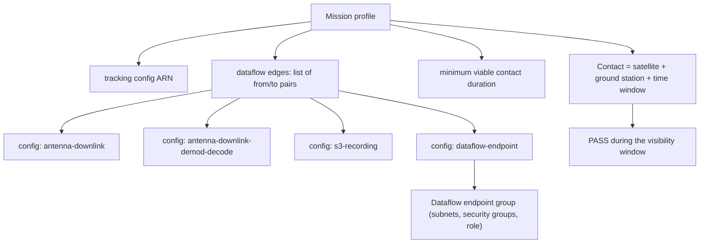
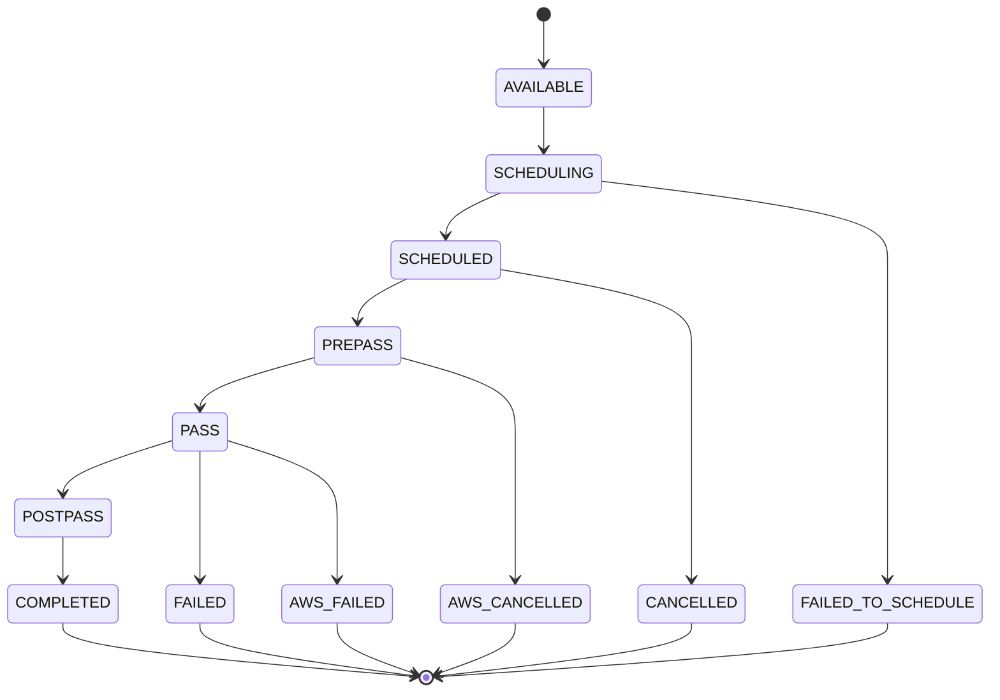
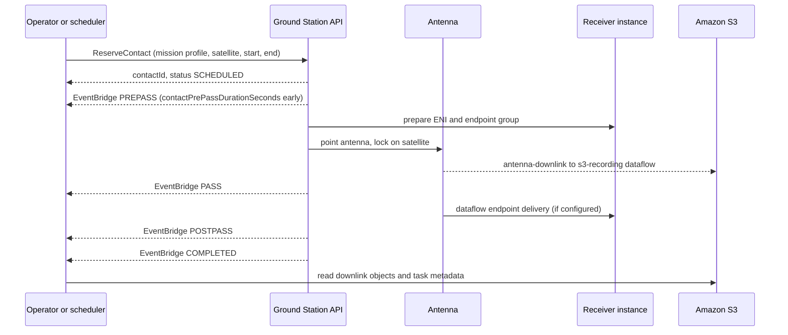

# 03 · AWS Ground Station

> **Phase 9 — Cutting-Edge AWS** · Lesson 03 of 06
> ⬅️ Previous: [Robotics on AWS](./02-aws-robomaker.md) · ➡️ Next: [Graviton and Sustainability](./04-graviton-and-sustainability.md) · 🏠 [Phase overview](./README.md)

## Learning Objectives

By the end of this lesson you will be able to:

- Explain ground-station-as-a-service and what AWS operates on your behalf
- Choose between S-band and X-band for a given mission, including uplink capability
- Describe a mission profile, a dataflow endpoint group, and a contact, and how they fit together
- Schedule a contact, land the downlink data in Amazon S3, and automate the surrounding workflow with EventBridge

**Estimated time:** 90 min · **Difficulty:** Advanced

---

## Core Concepts

A satellite is only useful when you can talk to it. That requires an antenna pointed at the right patch of sky at the right minute of the orbit — and antennas are expensive, licensed, geographically constrained assets. **AWS Ground Station** sells access to a global antenna network as a service. AWS owns the dishes, the spectrum licensing negotiations, the site operations, and the fiber backhaul; you reserve time on the network, describe where the data should land, and pay for the minutes you use.

The economics are the point. AWS claims you can **save up to 80% on ground station operations** by paying only for actual antenna time and reusing a shared global footprint instead of building, staffing, and licensing your own sites. There are no long-term commitments.

### What AWS operates

The public network has **11 ground station locations**, and they are not all physically inside the AWS Region they connect to:

| Ground station | Physical location | Connected AWS Region |
|----------------|-------------------|----------------------|
| Alaska 1 | Alaska, USA | `us-west-2` |
| Bahrain 1 | Bahrain | `me-south-1` |
| Cape Town 1 | Cape Town, South Africa | `af-south-1` |
| Dubbo 1 | Dubbo, Australia | `ap-southeast-2` |
| Hawaii 1 | Hawaii, USA | `us-west-2` |
| Ireland 1 | Ireland | `eu-west-1` |
| Ohio 1 | Ohio, USA | `us-east-2` |
| Oregon 1 | Oregon, USA | `us-west-2` |
| Punta Arenas 1 | Punta Arenas, Chile | `sa-east-1` |
| Singapore 1 | Singapore | `ap-southeast-1` |
| Stockholm 1 | Stockholm, Sweden | `eu-north-1` |

Note that Seoul is no longer supported. Beyond the public network, **Dedicated Antennas** are custom-built systems AWS manages for you at undisclosed locations, with capabilities beyond the public sites.

### Bands and capabilities

Every site supports the same capability set; what varies is weather, site mask, and the assignment of antennas to your contact. The independent communication paths you can request are:

| Capability | Frequency | Bandwidth | Direction |
|------------|-----------|-----------|-----------|
| X-band wideband downlink | 7750–8500 MHz | 50–400 MHz per path | Downlink |
| X-band narrowband downlink | 7750–8500 MHz | up to 40 MHz | Downlink |
| X-band demodulated and decoded downlink | 7750–8500 MHz | up to 500 MHz | Downlink |
| S-band downlink | 2200–2290 MHz | up to 40 MHz | Downlink |
| S-band uplink | 2025–2110 MHz | up to 40 MHz, EIRP 20–50 dBW | Uplink |
| Uplink echo | 2025–2110 MHz | 2 MHz | Monitor |
| Tracking | n/a | n/a | Auto and program tracking |

Two practical constraints matter more than the table suggests. First, **wideband X-band downlink requires the AWS Ground Station Agent** running on your EC2 receiver instance, and it is not supported at Alaska 1 or Punta Arenas 1. Second, aggregate bandwidth per polarization per location cannot exceed 400 MHz, and the frequency ranges you use must not overlap. Note also that S-band uplink and X-band narrowband downlink each allow only **one polarization at a time**.

**Choosing a band** comes down to data volume and link margin. S-band is lower frequency, so it tolerates a wider beam and simpler antennas but supports far less bandwidth — fine for telemetry, command, and small imaging payloads. X-band offers much higher bandwidth for high-resolution imagery and radar, at the cost of needing precise pointing and antenna gain. Missions commonly use S-band for uplink/telemetry and X-band for the payload downlink in the same contact.

### Use cases

Ground Station is not a niche service. Anything that produces data in orbit and wants it in a data lake is a candidate:

| Use case | Why ground stations matter | Typical band |
|----------|---------------------------|--------------|
| **Earth observation** | High-resolution imagery generates gigabytes per pass; the bottleneck is downlink capacity, not on-board storage | X-band wideband |
| **Weather monitoring** | Meteorological satellites downlink continuously and on tight schedules; latency directly affects forecast quality | X-band, some S-band |
| **Communications and broadcast** | Uplink and downlink for relay payloads and media distribution, with echo monitoring on the uplink | S-band uplink, X-band downlink |
| **Telemetry and command** | Small packets, high reliability, always needed — including for satellites whose payload downlink is handled elsewhere | S-band |
| **Science and research** | Cubesats and university missions that could never justify building a ground station | S-band, X-band |
| **Maritime, aviation, and IoT backhaul** | Sparse-coverage relay of asset data gathered in places with no terrestrial network | S-band |

Geography is a design constraint, not a detail. Polar-orbiting satellites pass near the poles every orbit and can only be seen from high-latitude sites, which is exactly why Alaska 1, Stockholm 1, and Punta Arenas 1 exist. Geostationary satellites never move relative to the ground, so a single well-placed site is enough.

### Onboarding, mission profiles, and contacts

Before you can do anything, your satellite must be **onboarded**: a questionnaire (mission summary, frequencies, launch date, orbit type), AWS-side regulatory spectrum licensing at each location you want, and NDAs. This is a manual process and takes time — plan for it before launch, not after.

Once onboarded, you build three objects:

1. A **mission profile** ties together a tracking configuration, a set of dataflow edges, and a minimum viable contact duration. It is the reusable definition of "how this satellite is talked to".
2. A **dataflow endpoint group** describes where data goes — either EC2 dataflow endpoints (subnet, security group, role, socket address, MTU) or AWS Ground Station Agent endpoints.
3. A **contact** is a reservation of antenna time for one satellite at one ground station between a start and end time. `ReserveContact` for a specific window.

Dataflows are node-and-edge graphs. A typical edge is `antenna-downlink` → `s3-recording`, which is asynchronous digitized RF delivered straight to your bucket. The wire format depends on the source: bandwidth up to 40 MHz arrives as VITA-49 Signal Data/IP packets, wider wideband downlink arrives as AWS Ground Station Class 2 packets, and demodulated/decoded downlink arrives as Demodulated/Decoded Data/IP packets.

---

## Architecture Diagram

From orbit to S3, including where encryption and IAM boundaries sit:

```mermaid
flowchart LR
    sat["Satellite in orbit"] -->|"S-band 2025-2290 MHz"| ant["AWS Ground Station antenna"]
    sat -->|"X-band 7750-8500 MHz"| ant
    ant --> mp["Mission profile + dataflow edges"]
    mp -->|"digitized RF or decoded frames"| eni["Ground Station managed ENI in your VPC"]
    eni --> recv["EC2 receiver instance (private subnet)"]
    eni -->|"s3-recording config"| s3[("Amazon S3 downlink bucket")]
    recv -->|"Ground Station Agent for wideband"| s3
    s3 --> eb["EventBridge on contact state change"]
    eb --> dec["Lambda: decode, checksum, publish manifest"]
    dec --> sns["Amazon SNS operator notification"]
    s3 --> proc["SageMaker or Lambda processing"]
    subgraph vpc["Your VPC"]
        eni
        recv
    end
```



How the objects reference each other — a config ARN appears as an endpoint of a dataflow edge:



The contact lifecycle, including the EventBridge events that let you automate around it:



What a nominal pass looks like from the scheduler's point of view:



---

## Hands-on Lab: Build a Mission Profile and Reserve a Contact

**Goal:** Create the S3 destination, endpoint group, and mission profile for a satellite, then reserve a contact and verify the data landing pattern using the digital twin feature — with no spectrum licensing required.

**Prerequisites:**

- An AWS account and CLI v2, plus a Region where AWS Ground Station is available
- A satellite already onboarded (or onboarded to the **digital twin** feature, which emits the same API responses and events as production)
- A VPC with a private subnet, a security group, and an IAM role Ground Station can assume to attach ENIs
- An S3 bucket for downlink data

### Step 1 — Inventory what AWS already knows about your mission

```bash
# List the ground stations you can schedule against, with their Regions
aws groundstation list-ground-stations --region us-west-2

# List the satellites tied to your account, with NORAD ID and permitted ground stations
aws groundstation list-satellites --region us-west-2

# See the available antennas at a site (requires an onboarded satellite or ephemeris permission)
aws groundstation list-antennas --ground-station-id "Oregon 1" --region us-west-2

# Capacity planning: what is already reserved at this site
aws groundstation list-ground-station-reservations \
  --ground-station-id "Oregon 1" --region us-west-2
```

Note the ARN shapes: satellite ARNs returned by `list-satellites` are global (`arn:aws:groundstation::123456789012:satellite/...`), while tagging requires a Region-qualified ARN.

### Step 2 — Create the S3 recording config and the tracking config

Configs are the building blocks referenced by ARNs inside a mission profile.

```bash
# Destination: write downlink data into this bucket using this role
aws groundstation create-config \
  --name s3-recording-xband \
  --config-data '{"s3RecordingConfig":{"bucketArn":"arn:aws:s3:::gs-downlink-123456789012","roleArn":"arn:aws:iam::123456789012:role/GroundStationS3RecordingRole","prefix":"xband/"}}' \
  --region us-west-2

# Tracking: program-track using an ephemeris you provide, or auto-track
aws groundstation create-config \
  --name tracking-program \
  --config-data '{"trackingConfig":{"autotrack":"PREFERRED"}}' \
  --region us-west-2

# Confirm the resulting config ARNs - note the config type appears in the ARN path
aws groundstation list-configs --region us-west-2 \
  --query 'configList[].{name:name,arn:configArn,type:configType}' --output table
```

### Step 3 — Create the dataflow endpoint group

```bash
# All endpoints in one group must be the same type: EC2 dataflow endpoints or Agent endpoints
aws groundstation create-dataflow-endpoint-group \
  --endpoint-details '[{
    "securityDetails": {
      "subnetIds": ["subnet-0abc123def4567890"],
      "securityGroupIds": ["sg-0abc123def4567890"],
      "roleArn": "arn:aws:iam::123456789012:role/GroundStationDataDeliveryRole"
    },
    "endpoint": {
      "name": "receiver-1",
      "address": { "name": "10.0.1.25", "port": 50000 },
      "mtu": 1500
    }
  }]' \
  --contact-pre-pass-duration-seconds 120 \
  --contact-post-pass-duration-seconds 60 \
  --region us-west-2
```

### Step 4 — Create the mission profile

`dataflowEdges` is a list of lists: each inner list is two config ARNs, a *from* and a *to*.

```bash
aws groundstation create-mission-profile \
  --name aqua-xband-downlink \
  --minimum-viable-contact-duration-seconds 180 \
  --tracking-config-arn arn:aws:groundstation:us-west-2:123456789012:config/tracking/11111111-2222-3333-4444-555555555555 \
  --dataflow-edges '[["arn:aws:groundstation:us-west-2:123456789012:config/antenna-downlink/11111111-2222-3333-4444-555555555555","arn:aws:groundstation:us-west-2:123456789012:config/s3-recording/66666666-7777-8888-9999-000000000000"]]' \
  --contact-pre-pass-duration-seconds 120 \
  --contact-post-pass-duration-seconds 60 \
  --streams-kms-key '{"kmsAliasName":"alias/gs-downlink"}' \
  --streams-kms-role arn:aws:iam::123456789012:role/GroundStationKmsRole \
  --tags '{"mission":"aqua","band":"x"}' \
  --region us-west-2
```

### Step 5 — Reserve a contact and watch the events

```bash
# Reserve antenna time. Use ISO 8601 UTC timestamps from your orbit propagator.
aws groundstation reserve-contact \
  --mission-profile-arn arn:aws:groundstation:us-west-2:123456789012:mission-profile/aaaaaaaa-bbbb-cccc-dddd-eeeeeeeeeeee \
  --satellite-arn arn:aws:groundstation::123456789012:satellite/11111111-2222-3333-4444-555555555555 \
  --ground-station "Oregon 1" \
  --start-time "2026-11-01T12:34:56Z" \
  --end-time "2026-11-01T12:41:20Z" \
  --tags '{"pass":"aqua-001"}' \
  --region us-west-2

# Query it back and watch the status progress from SCHEDULED to COMPLETED
aws groundstation describe-contact --contact-id 98ddd10f-f2bc-479c-bf7d-55644737fb09 --region us-west-2
aws groundstation list-contacts --status-list COMPLETED --region us-west-2

# Cancel if the orbit changes (allowed until the pass starts)
aws groundstation cancel-contact --contact-id 98ddd10f-f2bc-479c-bf7d-55644737fb09 --region us-west-2
```

Wire the state changes into automation with the event structure Ground Station emits:

```json
{
  "source": "aws.groundstation",
  "detailType": "Ground Station Contact State Change",
  "detail": {
    "contactId": "98ddd10f-f2bc-479c-bf7d-55644737fb09",
    "groundstationId": "Oregon 1",
    "missionProfileArn": "arn:aws:groundstation:us-west-2:123456789012:mission-profile/aaaaaaaa-bbbb-cccc-dddd-eeeeeeeeeeee",
    "satelliteArn": "arn:aws:groundstation::123456789012:satellite/11111111-2222-3333-4444-555555555555",
    "contactStatus": "PASS"
  }
}
```

```bash
# Start a decoder when the pass ends
aws events put-rule \
  --name gs-contact-completed \
  --event-pattern '{"source":["aws.groundstation"],"detail-type":["Ground Station Contact State Change"],"detail":{"contactStatus":["COMPLETED"]}}'

aws events put-targets --rule gs-contact-completed \
  --targets '[{"Id":"start-decoder","Arn":"arn:aws:lambda:us-west-2:123456789012:function:DecodeDownlink"}]'
```

### Step 6 — Verify

```bash
# Digital twin produces the same API responses and events without spectrum licensing,
# but it does NOT deliver data. Verify the schedule and the event flow there first.
aws groundstation describe-contact --contact-id <digital-twin-contact-id> --region us-west-2

# On the production path, confirm objects landed in the bucket
aws s3 ls s3://gs-downlink-123456789012/xband/ --recursive | head

# Check the harness recorded the contact itself
aws groundstation list-contacts --start-time "2026-11-01T00:00:00Z" --end-time "2026-11-02T00:00:00Z" \
  --region us-west-2 --query 'contactList[].[contactId,contactStatus,groundStation]' --output table
```

Success looks like: a mission profile you can reuse, a contact reaching `COMPLETED`, objects appearing under the bucket prefix you configured (production only), and a Lambda invocation triggered by the `COMPLETED` event. Remember that AWS Ground Station retains contact data for **one year** after you reserve a contact — export anything you need to keep.

---

## CLI Reference

```bash
# Discovery
aws groundstation list-ground-stations
aws groundstation list-satellites
aws groundstation list-antennas --ground-station-id "Ohio 1"

# Building blocks
aws groundstation create-config --name <name> --config-data file://config.json
aws groundstation list-configs
aws groundstation create-dataflow-endpoint-group --endpoint-details file://endpoints.json
aws groundstation create-mission-profile --name <name> \
  --tracking-config-arn <arn> --dataflow-edges file://edges.json \
  --minimum-viable-contact-duration-seconds 180

# Contacts
aws groundstation reserve-contact --mission-profile-arn <arn> --satellite-arn <arn> \
  --ground-station "Oregon 1" --start-time "2026-11-01T12:34:56Z" --end-time "2026-11-01T12:41:20Z"
aws groundstation describe-contact --contact-id <id>
aws groundstation list-contacts --status-list SCHEDULED
aws groundstation cancel-contact --contact-id <id>

# Capacity and identity
aws groundstation list-ground-station-reservations --ground-station-id "Oregon 1"
aws groundstation tag-resource --resource-arn <regional-arn> --tags '{"pass":"aqua-001"}'

# Automation
aws events put-rule --name gs-contact-completed --event-pattern file://pattern.json
```

| Command | Purpose |
|---------|---------|
| `list-ground-stations` | Discover sites and their connected Regions |
| `create-config` | Define the s3-recording, tracking, or dataflow node |
| `create-dataflow-endpoint-group` | Declare subnet, security group, role, and socket targets |
| `create-mission-profile` | Bind a satellite's reusable contact definition |
| `reserve-contact` | Buy a specific window of antenna time |
| `describe-contact` / `list-contacts` | Track status and build pass manifests |
| `cancel-contact` | Release a window before the pass begins |

---

## Best Practices

| Practice | Why it matters |
|----------|----------------|
| Set `contactPrePassDurationSeconds` deliberately | It controls how early your automation can start an instance or mount a volume |
| Protect against missed passes with idempotent receivers | Antenna time is non-refundable; a receiver that is not ready wastes the whole pass |
| Use the digital twin feature before go-live | Validate scheduling logic and error handling without spectrum licensing |
| Provide your own ephemeris when you have it | Program tracking beats blind auto-tracking for agile satellites |
| Keep one mission profile per band and dataflow shape | Makes contacts predictable and auditable |
| Tag satellites, contacts, and profiles consistently | Correlating passes to missions by hand does not scale past a few satellites |
| Encrypt streams with `--streams-kms-key` | Downlink data is often the most sensitive output of the mission |
| Build automation on EventBridge, not polling | State changes are pushed; polling burns API calls and misses timing |
| Account for the one-year contact data retention | Export contact records if you need a longer mission archive |

---

## Common Pitfalls

| Pitfall | Symptom | Fix |
|---------|---------|-----|
| Assuming onboarding is instant | Months of delay between launch and first contact | Start the questionnaire, licensing, and NDA process early |
| Mixing endpoint types in one group | `create-dataflow-endpoint-group` rejects the request | Keep EC2 dataflow endpoints and Agent endpoints in separate groups |
| Expecting wideband X-band everywhere | No wideband capability at Alaska 1 or Punta Arenas 1 | Check site capabilities and consider a different location |
| Forgetting the Ground Station Agent | Wideband downlink never arrives on the receiver | Install and register the agent, and check `update-agent-status` |
| Treating digital twin as production | Expecting data to arrive | Digital twin has no data delivery and no telemetry |
| Scheduling outside the visibility window | `FAILED_TO_SCHEDULE` | Generate windows from an up-to-date TLE or your own ephemeris |
| Region mismatch between CLI and resources | `ResourceNotFound` on configs that clearly exist | Pass `--region` matching the config ARN, or set a default profile |
| Receiver instance not ready at PREPASS | Pass completes with no usable data | Use the PREPASS event to start and warm the instance |
| Ignoring polarization limits | Uplink or narrowband downlink request rejected | Use one polarization at a time for those capabilities |

---

## Cost Considerations

Ground Station pricing has two components, and only one of them is obviously visible:

- **Antenna time**, billed per minute of contact, varies by band, capability, and location. This is the line item you can control by reserving shorter passes.
- **Data delivery**, billed per GB moved to your VPC or S3, is the line item that surprises people with high-resolution payloads.

The cost arithmetic for a mission is straightforward once you know your duty cycle: passes per day × minutes per pass × rate, plus GB downlinked per day × per-GB rate. Because both scale linearly, the two real levers are (a) downlinking only what you need, using on-board processing to discard empty frames, and (b) consolidating many small contacts into fewer, longer ones where the orbit allows.

Everything downstream is ordinary AWS pricing: S3 storage and requests for downlinked objects, EC2 receiver instances (billed only if you leave them running — start them from the PREPASS event), KMS requests for stream encryption, and Lambda/EventBridge costs, which are negligible at mission scale. Add an S3 lifecycle rule for downlink buckets, because raw downlink data is both large and rarely needed in its raw form after decoding.

AWS publishes the "up to 80% savings versus building your own ground station" claim based on avoiding capital construction and site operations. That comparison is fair for a small operator and increasingly unfair for one with dozens of satellites — at that scale, evaluate Dedicated Antennas before defaulting to the public network.

---

## Security Considerations

- **End-to-end encryption is your responsibility.** AWS explicitly recommends implementing encryption and provides APIs to integrate it; the service does not magically secure your payload. Encrypt command links and telemetry, and treat the ground segment as one part of the chain.
- **Streams can be encrypted with KMS.** `create-mission-profile` accepts `--streams-kms-key` and `--streams-kms-role`; use a customer-managed key so you can revoke access to a downlink stream independently of the bucket policy.
- **The ENI role is a network foothold.** The `securityDetails.roleArn` lets Ground Station create elastic network interfaces in your VPC. Scope it, place endpoints in private subnets, and make the security group accept traffic only from the Ground Station path on the specific ports you declared.
- **Spacecraft command authority is a security boundary.** Uplink capability means that a compromised AWS credential can potentially command a satellite. Separate the uplink role from the downlink role, require MFA for uplink operations, and log every `ReserveContact` with uplink dataflows to CloudTrail with an alert.
- **Segment the VPC.** Receiver instances should sit in their own subnet with no route to general-purpose workloads, and reachable only through Systems Manager, never SSH.
- **Use the digital twin for integration testing.** It also serves as a security control: mission-planning software can be validated before it is ever allowed near production antenna capacity.
- **Watch the contact data retention window.** Contact records are deleted one year after reservation. If your compliance regime requires a permanent pass log, export contact data into a bucket with Object Lock.
- **Licensing is a legal control, not just a technical one.** AWS obtains regulatory licensing on your behalf at the locations you request; operating outside those approvals is your liability, not AWS's.

---

## Exercise

Design a complete mission plan for a 6U Earth-observation cubesat in a 500 km sun-synchronous orbit. Decide which ground stations you would use for a daily downlink, which band for payload versus telemetry, and how many contacts per day you need to move 1.5 GB of imagery. Then implement it with `create-config`, `create-mission-profile`, and `reserve-contact` against the digital twin, and write an EventBridge rule that starts a decoder only when `contactStatus` is `PASS`.

Success looks like: a mission profile ARN, three reserved contacts that return `SCHEDULED`, a JSON event pattern, and a paragraph justifying your band choice with a rough link-budget or data-volume argument.

---

## Resources

- [AWS Ground Station Locations](https://docs.aws.amazon.com/ground-station/latest/ug/aws-ground-station-antenna-locations.html)
- [AWS Ground Station Site Capabilities](https://docs.aws.amazon.com/ground-station/latest/ug/locations.capabilities.html)
- [Understand contact lifecycle](https://docs.aws.amazon.com/ground-station/latest/ug/contacts.lifecycle.html)
- [Work with dataflows](https://docs.aws.amazon.com/ground-station/latest/ug/dataflows.html)
- [Use the AWS Ground Station digital twin feature](https://docs.aws.amazon.com/ground-station/latest/ug/digital-twin.html)
- [Automate AWS Ground Station with Events](https://docs.aws.amazon.com/ground-station/latest/ug/monitoring.automating-events.html)
- [Security in AWS Ground Station](https://docs.aws.amazon.com/ground-station/latest/ug/security.html)
- [Ground Station CLI reference](https://docs.aws.amazon.com/cli/latest/reference/groundstation/)

---

## Next Steps

Space hardware is the extreme case of a constrained, expensive resource. The next lesson asks the opposite question: how much of your *ordinary* compute could be running cheaper and with lower emissions on ARM64 right now?

> ⬅️ Previous: [Robotics on AWS](./02-aws-robomaker.md) · ➡️ Next: [Graviton and Sustainability](./04-graviton-and-sustainability.md) · 🏠 [Phase overview](./README.md)
