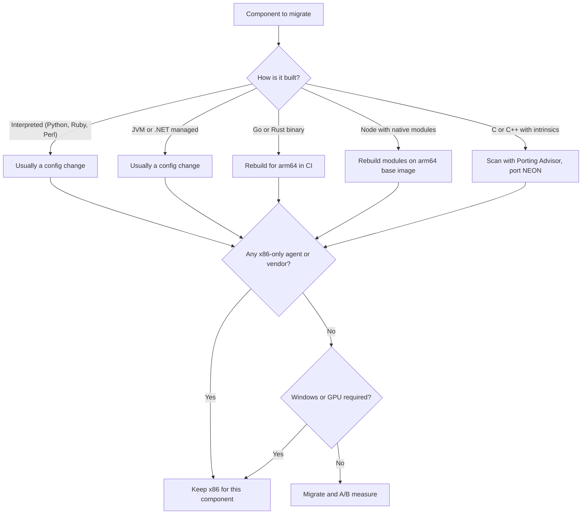
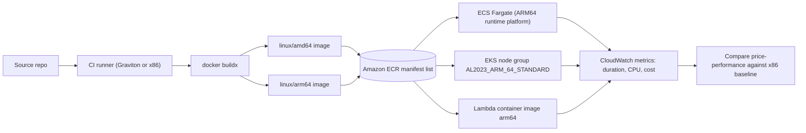
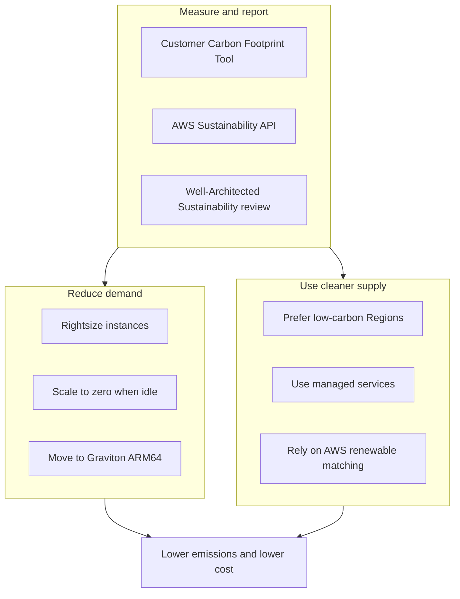
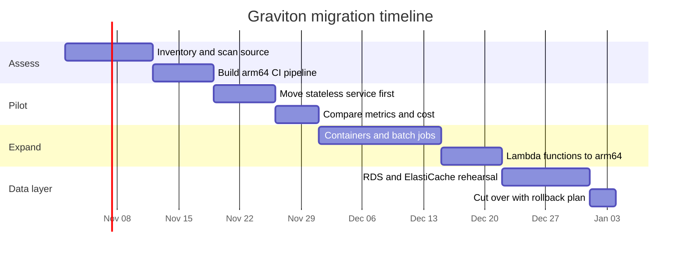

# 04 · Graviton and Sustainability

> **Phase 9 — Cutting-Edge AWS** · Lesson 04 of 06
> ⬅️ Previous: [AWS Ground Station](./03-aws-ground-station.md) · ➡️ Next: [AIOps and AI-Powered Infrastructure](./05-aiops-and-ai-powered-infrastructure.md) · 🏠 [Phase overview](./README.md)

## 🎯 Learning Objectives

By the end of this lesson you will be able to:

- Explain what AWS Graviton is and why ARM64 changes the price-performance calculation
- Migrate a Lambda function, a container, and a database to Graviton and measure the difference
- Identify the real compatibility blockers before you commit to a migration
- Report your estimated carbon emissions with the Customer Carbon Footprint Tool and the AWS Sustainability API
- Choose Regions and architectures that lower both the bill and the footprint

**Estimated time:** 70 min · **Difficulty:** Intermediate

---

## 🧠 Core Concepts

### What Graviton is

AWS Graviton is a family of **ARM64** processors designed by AWS (through Annapurna Labs) and built for cloud workloads rather than for a general-purpose hardware market. Because AWS controls both the chip and the hypervisor, it can tune cache sizes, memory bandwidth, and power for the shapes of workload that actually run in EC2.

| Generation | Introduced | Representative families | What changed |
|------------|-----------|-------------------------|--------------|
| Graviton | 2018 | `a1` | First ARM64 option, burstable and scale-out only |
| Graviton2 | 2020 | `m6g`, `c6g`, `r6g`, `t4g` | 7 nm, a large generational price-performance jump over comparable x86 |
| Graviton3 | 2022 | `m7g`, `c7g`, `r7g` | DDR5, up to 25% better compute performance than Graviton2 |
| Graviton3E | 2023 | `hpc7g` | HPC-optimized vector throughput |
| Graviton4 | 2024 | `m8g`, `c8g`, `r8g`, `x8g` | Wider core, better memory bandwidth and latency, up to 30% better performance than Graviton3 |
| Graviton5 | 2026 | newest generation | 192 cores, a 5x larger cache, and up to 33% lower inter-core latency per AWS's own description |

Graviton covers far more than EC2: Lambda (`arm64`), Fargate, ECS and EKS, Amazon RDS (MySQL, PostgreSQL, MariaDB, and Aurora), ElastiCache, MemoryDB, OpenSearch, MSK, EMR, AWS Batch, SageMaker, Neptune, DocumentDB, and more. The practical consequence is that "migrate to Graviton" is no longer a single decision — it is a per-component decision you can take incrementally.

### Why the price-performance argument is real

Two mechanisms stack. First, for many workloads Graviton gives **more performance per vCPU** than a comparable x86 instance: JVM workloads, Go and Rust services, containerized web tiers, and databases benefit from the wider memory path. Second, ARM64 instances are cheaper per hour at the same nominal size. AWS quotes up to 40% better price-performance for Graviton2 versus comparable x86 instances, and a 20% price-performance benefit for Lambda functions compiled for `arm64`.

The honest caveat is that the benchmark you care about is your own. A workload dominated by a single-threaded dependency on an old `manylinux2014` x86-only wheel will not benefit at all, and a workload that shells out to an x86-only third-party agent cannot move until that vendor ships `aarch64`.

### Compatibility blockers, ranked by how often they actually bite

1. **Windows.** Graviton is Linux-only. Windows Server workloads cannot migrate.
2. **GPU and CUDA.** No Graviton instance has GPUs. ML training on NVIDIA hardware stays on x86 (or moves to AWS Trainium/Inferentia, a different decision).
3. **Native and compiled dependencies.** Python wheels must have an `aarch64` `manylinux` build, Node.js `node-gyp` modules must compile for ARM, and any C/C++ dependency built at install time needs a toolchain on the target image. Build multi-arch images rather than copying `node_modules` between architectures.
4. **x86-only ISVs.** Endpoint agents, DLP tools, legacy JDBC drivers, and some database clients remain x86-only. This is the most common reason a migration stalls halfway.
5. **Hand-written SIMD intrinsics.** Code using SSE/AVX intrinsics needs NEON equivalents or a scalar fallback. The Porting Advisor for Graviton exists specifically to find these.
6. **Licensing.** Older commercial database versions may not be licensed for ARM64. Check before you plan the migration of a database.
7. **Region coverage.** Newer families land in major Regions first. Check instance availability for your Region and AZ before committing.

### Sustainability, measured rather than asserted

The **AWS Customer Carbon Footprint Tool** is free and lives in the Billing and Cost Management console. It reports estimated monthly emissions using the market-based method, broken down by service and Region, distinguishing gross emissions from net emissions after AWS's renewable energy purchases and offsets. Data lags by roughly three months, and the tool is a *tool*, not an audit — it is designed for tracking trends, not for reporting under a regulatory framework.

For programmatic access, the **AWS Sustainability API** exposes estimated environmental impact: `GetEstimatedCarbonEmissions`, `GetEstimatedWaterAllocation`, and dimension-value operations, with grouping by account, Region, and service, monthly/quarterly/yearly granularity, and both location-based and market-based methodologies.

Two facts make these numbers actionable. AWS has matched 100% of the electricity used by its global operations with renewable energy, and Amazon's Climate Pledge commits to net-zero carbon by 2040. But grid carbon intensity still varies enormously by Region, which is why **Region selection is a sustainability lever** — workloads in Stockholm, Ireland, or Oregon are typically cleaner than workloads in Regions powered by coal-heavy grids, and AWS's own well-architected guidance tells you to prefer low-carbon Regions when latency and data residency allow.

The **Sustainability Pillar** of the AWS Well-Architected Framework (added in 2021) is the sixth pillar and gives you the vocabulary: understand your impact, establish sustainability goals, maximize utilization, anticipate and adopt new, more efficient hardware and software offerings, use managed services, and reduce the downstream impact of your cloud workloads.

---

## 🗺️ Architecture Diagram

A per-component migration decision, which is how Graviton migrations actually succeed:



A single build pipeline producing one manifest list that runs on both architectures:



Where the sustainability levers actually attach:



A realistic migration sequence, because doing it all at once is how migrations fail:



---

## 🧪 Hands-on Lab: Measure a Graviton Migration

**Goal:** Move one Lambda function, one container service, and one database instance to Graviton, and produce evidence that the change helped.

**Prerequisites:**

- AWS CLI v2, Docker with Buildx, and a Python or Node service to migrate
- An existing container image in Amazon ECR or CodeCommit/GitHub source
- Permission to change Lambda configuration, ECS task definitions, and RDS instance classes
- A CloudWatch dashboard or a notebook where you can compare before/after metrics

### Step 1 — Scan the source for portability problems

```bash
# Porting Advisor for Graviton statically scans source for x86-specific assumptions.
# Download the release for your platform and run it against the source tree; it writes an HTML report.
# Note in the report: x86 intrinsics, compiler flags, and architecture-pinned dependencies.
curl -sL -o porting-advisor.zip \
  https://github.com/aws/porting-advisor-for-graviton/releases/latest/download/porting-advisor-linux-x86_64.zip
unzip -q porting-advisor.zip -d ./porting-advisor
./porting-advisor/porting-advisor ./src --output ./porting-report
```

### Step 2 — Build a multi-arch image rather than a second copy of the app

```bash
# Authenticate to ECR
aws ecr get-login-password --region eu-west-1 \
  | docker login --username AWS --password-stdin 123456789012.dkr.ecr.eu-west-1.amazonaws.com

# One builder that can emit both architectures
docker buildx create --name multiarch --use
docker buildx inspect --bootstrap

# Build and push a manifest list: the same tag resolves to amd64 or arm64 per node type
docker buildx build \
  --platform linux/amd64,linux/arm64 \
  -t 123456789012.dkr.ecr.eu-west-1.amazonaws.com/orders-api:2.0.0 \
  --push .
```

```bash
# Confirm the manifest really contains both architectures
aws ecr describe-images \
  --repository-name orders-api \
  --image-ids imageTag=2.0.0 \
  --query 'imageDetails[0].imageManifest' --output text | head -c 400
```

### Step 3 — Run it on Graviton in ECS Fargate

```json
{
  "family": "orders-api",
  "runtimePlatform": {
    "cpuArchitecture": "ARM64",
    "operatingSystemFamily": "LINUX"
  },
  "networkMode": "awsvpc",
  "requiresCompatibilities": ["FARGATE"],
  "cpu": "1024",
  "memory": "2048",
  "executionRoleArn": "arn:aws:iam::123456789012:role/ecsTaskExecutionRole",
  "containerDefinitions": [
    {
      "name": "orders-api",
      "image": "123456789012.dkr.ecr.eu-west-1.amazonaws.com/orders-api:2.0.0",
      "portMappings": [{ "containerPort": 8080, "protocol": "tcp" }],
      "logConfiguration": {
        "logDriver": "awslogs",
        "options": {
          "awslogs-group": "/ecs/orders-api",
          "awslogs-region": "eu-west-1",
          "awslogs-stream-prefix": "ecs"
        }
      }
    }
  ]
}
```

```bash
# Register the ARM64 task definition and roll the service
aws ecs register-task-definition --cli-input-json file://arm64-task-def.json
aws ecs update-service --cluster prod --service orders-api \
  --task-definition orders-api --force-new-deployment

# For EKS, create an ARM64 managed node group for the same workloads
aws eks create-nodegroup \
  --cluster-name platform \
  --nodegroup-name graviton-nodes \
  --ami-type AL2023_ARM_64_STANDARD \
  --instance-types m8g.large c8g.xlarge \
  --scaling-config minSize=1,maxSize=20,desiredSize=3 \
  --node-role arn:aws:iam::123456789012:role/eksNodeRole
```

### Step 4 — Switch a Lambda function to arm64

```bash
# Existing x86 function: record the baseline first
aws lambda get-function-configuration --function-name image-resizer \
  --query '{arch:Architectures,mem:MemorySize,timeout:Timeout}'

# Flip the architecture. If the deployment package includes native extensions,
# rebuild it on an arm64 builder first - do not reuse x86 .so files.
aws lambda update-function-configuration \
  --function-name image-resizer \
  --architectures arm64

# Verify, then compare Duration, ConcurrentExecutions, and Duration-based cost
aws lambda get-function-configuration --function-name image-resizer \
  --query 'Architectures'
```

```bash
# Rebuild a native-extension layer for arm64 with the SAM/container build path
sam build --use-container --build-image public.ecr.aws/sam/build-python3.13:latest-arm64
sam deploy --stack-name image-resizer-arm64
```

### Step 5 — Move a database instance class

```bash
# Create the target from a snapshot first: this is the rehearsal, not the cutover
aws rds modify-db-instance \
  --db-instance-identifier orders-db \
  --db-instance-class db.m7g.large \
  --apply-immediately

# ElastiCache node type change follows the same pattern
aws elasticache modify-cache-cluster \
  --cache-cluster-id orders-cache \
  --cache-node-type cache.m7g.large \
  --apply-immediately
```

### Step 6 — Verify with evidence, and report the emissions

```bash
# Compare p99 duration and CPU utilization across the deployment window
aws cloudwatch get-metric-statistics --namespace AWS/ECS \
  --metric-name CPUUtilization \
  --dimensions Name=ClusterName,Value=prod Name=ServiceName,Value=orders-api \
  --start-time "$(date -u -v-3d +%Y-%m-%dT%H:%M:%SZ)" \
  --end-time "$(date -u +%Y-%m-%dT%H:%M:%SZ)" \
  --period 3600 --statistics Average

# Spot-check that the ARM64 task is actually running
aws ecs describe-tasks --cluster prod \
  --tasks $(aws ecs list-tasks --cluster prod --service-name orders-api --query 'taskArns[0]' --output text) \
  --query 'tasks[0].{arch:runtimePlatform.cpuArchitecture,last:cpuUtilization}'

# Pull estimated emissions from the Sustainability API
aws sustainability get-estimated-carbon-emissions \
  --generate-cli-skeleton input > carbon-request.json

aws sustainability get-estimated-carbon-emissions \
  --cli-input-json file://carbon-request.json --region us-east-1
```

Success looks like: the same application digest running as `ARM64` in ECS, a Lambda function reporting `arm64`, a database on `db.m7g`, and a before/after table showing equal or better p99 duration at a lower hourly rate. If the numbers are flat, say so — a flat result is a real finding, not a failure.

---

## 💻 CLI Reference

```bash
# Which architectures does this Lambda support?
aws lambda get-function-configuration --function-name <name> --query Architectures

# Instance families and where they are available
aws ec2 describe-instance-types --filters Name=architecture,Values=arm64 \
  --query 'InstanceTypes[].[InstanceType,VCpuInfo.DefaultVCpus,MemoryInfo.SizeInMiB]' --output table
aws ec2 describe-instance-type-offerings --location-type availability-zone \
  --filters Name=instance-type,Values=m8g.large --region eu-west-1

# RDS and ElastiCache Graviton classes
aws rds describe-orderable-db-instance-options --engine postgres \
  --query 'OrderableDBInstanceOptions[?contains(DBInstanceClass, `g.`)].DBInstanceClass' --output text
aws elasticache describe-cache-engine-versions --engine redis --query 'CacheEngineVersions[0].CacheEngineVersionDescription'

# Emissions reporting
aws sustainability get-estimated-carbon-emissions --cli-input-json file://carbon-request.json
aws sustainability get-estimated-carbon-emissions-dimension-values --region us-east-1

# Cost impact of the change
aws ce get-cost-and-usage --time-period Start=2026-10-01,End=2026-11-01 \
  --granularity MONTHLY --metrics UnblendedCost \
  --group-by Type=DIMENSION,Key=INSTANCE_TYPE
```

| Command | Purpose |
|---------|---------|
| `describe-instance-types --filters architecture=arm64` | Find Graviton options and sizes |
| `describe-instance-type-offerings` | Confirm availability in a specific AZ |
| `lambda update-function-configuration --architectures arm64` | Cheapest possible Graviton migration |
| `ecs register-task-definition` with `cpuArchitecture: ARM64` | Run Fargate/EC2 tasks on Graviton |
| `eks create-nodegroup --ami-type AL2023_ARM_64_STANDARD` | Add ARM64 capacity to a cluster |
| `rds modify-db-instance --db-instance-class db.m7g.large` | Move a managed database to Graviton |
| `sustainability get-estimated-carbon-emissions` | Pull estimated emissions programmatically |

---

## ✅ Best Practices

| Practice | Why it matters |
|----------|----------------|
| Build multi-arch images, never copy artifacts between architectures | Native `.so` and `node_modules` are architecture-specific |
| Migrate stateless services before stateful ones | Fast rollback, no data migration risk |
| Keep an x86 task definition during the pilot | Instance-level rollback in seconds, not a redeploy |
| Measure p99 latency and CPU, not just cost | A cheaper instance that misses SLOs is not cheaper |
| Scan source with the Porting Advisor before promising a date | Finds the intrinsics that will blow the estimate |
| Pin `--architectures` explicitly for Lambda | The default is still `x86_64` on new functions |
| Upgrade the generation, not just the architecture | `m6g` to `m8g` is often a bigger win than x86 to ARM |
| Set a sustainability goal you can measure | "Reduce estimated emissions 20% by Q3" beats "go green" |
| Prefer Regions with low-carbon grids where latency permits | Region choice is a larger lever than instance choice for many workloads |
| Use the Well-Architected Sustainability Pillar as a review checklist | Turns intent into specific, testable practices |

---

## ⚠️ Common Pitfalls

| Pitfall | Symptom | Fix |
|---------|---------|-----|
| Reusing x86 wheels or `.so` files | `Exec format error` or `cannot open shared object file` | Rebuild on an `aarch64` base image |
| Assuming Windows works | No compatible instance types | Stay on x86 for Windows; ARM64 is Linux only |
| Expecting GPU workloads to move | No GPU on Graviton | Keep x86 (or evaluate Trainium/Inferentia separately) |
| Migrating a database on an old engine version | Instance class rejected | Check engine version support for ARM64 first |
| Third-party agent without an ARM build | Installer fails at 3 a.m. after cutover | Inventory agents before the migration, not during |
| Testing only with synthetic load | Real workload behaves differently on ARM64 | Replay production traffic to a canary |
| Changing architecture and instance size at once | Results are uninterpretable | Change one variable per deployment |
| Reading the carbon tool as an audit report | Numbers differ from a compliance filing | Treat it as trend data; use a certified methodology for reporting |
| Ignoring `--region` on sustainability calls | Empty result set | The Sustainability API is regional; use a supported Region |

---

## 💰 Cost Considerations

Graviton's financial case rests on two numbers per workload: the **hourly rate** of the ARM64 instance versus the comparable x86 instance, and **how much work** each does. The second matters more. Comparing `m8g.xlarge` to `m7i.xlarge` on price alone tells you nothing if your p99 latency doubles.

AWS's published figures are a starting point: up to 40% better price-performance for Graviton2 compared with comparable x86 instances, up to 30% better performance from Graviton4 versus Graviton3, and a 20% price-performance improvement for Lambda `arm64` at a 20% lower price per GB-second. Treat the published numbers as a hypothesis and your own benchmark as the answer.

Where the savings land:

- **Lambda**: `arm64` is priced lower per GB-second than `x86_64`. For a function that runs 200 million times a month at 200 ms and 512 MB, moving to a 20% cheaper GB-second is a real, if modest, annual saving before any performance change.
- **ECS/EKS/Fargate**: Fargate ARM64 is priced below the equivalent x86 configuration, and Graviton EC2 families cost less on-demand and on Spot.
- **RDS/Aurora**: `db.m7g` and `db.r8g` classes are typically cheaper than x86 equivalents at similar capacity, and the instance is often the largest single line item in a database bill.
- **ElastiCache/MemoryDB**: node type changes are often the simplest migration of all, since the data layer is managed.

Do not forget the migration cost itself: engineering time, a longer CI matrix, dual-architecture test runs, and possibly a temporary period where you pay for both an x86 and an ARM64 environment. A migration that saves 15% on a $500 monthly compute bill is not worth three engineer-weeks.

On the sustainability side, the Customer Carbon Footprint Tool and the Sustainability API are **free**, and the Well-Architected Sustainability Pillar review is free. The spend that reduces emissions is usually the same spend that reduces cost — rightsizing, consolidation, and generation upgrades — which makes sustainability a rare case where the green option and the cheap option are usually the same option.

---

## 🔐 Security Considerations

- **Architecture does not change your threat model.** Graviton runs the same Linux kernel, the same IAM, and the same VPC controls. Do not treat an ARM64 migration as a security improvement, and do not skip the normal review because "it is only a rebuild".
- **Rebuild from source, never from a copied build output.** Copying binaries between architectures is a supply-chain risk: it looks like it works until a subtly wrong artifact ships. Reproducible builds from a pinned, multi-arch base image are the control.
- **Pin base image digests, not tags.** Multi-arch tags resolve to different digests per architecture; `FROM python:3.13@sha256:...` keeps the amd64 and arm64 builds equally reproducible.
- **Watch IAM for the CI builder role.** A multi-arch pipeline needs push access to ECR and often cross-architecture build minutes. Scope that role to specific repositories and avoid wildcard `ecr:*`.
- **Keep KMS symmetric keys architecture-agnostic.** Encryption keys are not tied to silicon, but the *client* SDK version is — verify that your KMS/Graviton crypto paths are the same libs you audited.
- **Carbon and emissions data are billing metadata.** Access to the Sustainability API and the footprint tool reveals organizational structure; restrict it the same way you restrict Cost Explorer.
- **Third-party agents are the real security blocker.** Endpoint protection, EDR, and logging agents often lack `aarch64` builds. Discover this before the migration, or you will ship an instance that is technically compliant with the architecture goal and operationally non-compliant with your own controls.
- **Enforce architecture at admission time.** For Kubernetes, use a node selector or `nodeAffinity` on `kubernetes.io/arch`, and reject manifests without an explicit architecture so that an x86 image never lands on a Graviton node by accident.

---

## 🧩 Exercise

Pick one non-trivial service in the repo you work with and migrate it to Graviton. Measure four numbers before and after: p50 and p99 latency, CPU utilization at steady state, hourly cost, and emissions trend for the Region. Then answer, in one paragraph, whether the migration was worth it and what would have to be true for it to be worth it at 10x the traffic.

Success looks like: a table with the four metrics before and after, a commit or PR showing the architecture change in code (not just in the console), and an explicit statement of what you could *not* migrate and why.

---

## 📚 Resources

- [AWS Graviton](https://aws.amazon.com/ec2/graviton/)
- [Graviton getting started and migration guide](https://github.com/aws/aws-graviton-getting-started)
- [Porting Advisor for Graviton](https://github.com/aws/porting-advisor-for-graviton)
- [Lambda: Lambda instruction set architectures](https://docs.aws.amazon.com/lambda/latest/dg/foundation-arch.html)
- [Amazon RDS DB instance classes](https://docs.aws.amazon.com/AmazonRDS/latest/UserGuide/Concepts.DBInstanceClass.html)
- [AWS Well-Architected Sustainability Pillar](https://docs.aws.amazon.com/wellarchitected/latest/sustainability-pillar/sustainability-pillar.html)
- [Customer Carbon Footprint Tool](https://aws.amazon.com/aws-cost-management/aws-customer-carbon-footprint-tool/)
- [AWS Sustainability API Reference](https://docs.aws.amazon.com/sustainability/latest/APIReference/Welcome.html)

---

## ➡️ Next Steps

Efficiency is a lever you pull yourself. The next lesson covers the levers AWS pulls for you — and the uncomfortable question of which AIOps claims survive contact with a real incident.

> ⬅️ Previous: [AWS Ground Station](./03-aws-ground-station.md) · ➡️ Next: [AIOps and AI-Powered Infrastructure](./05-aiops-and-ai-powered-infrastructure.md) · 🏠 [Phase overview](./README.md)
