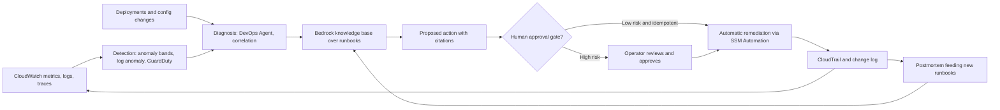
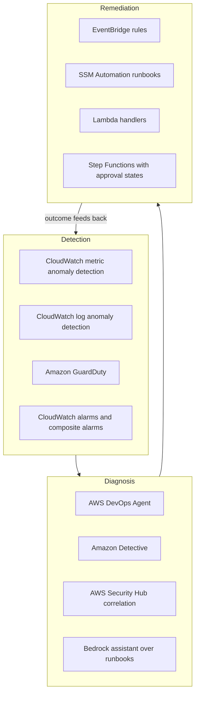
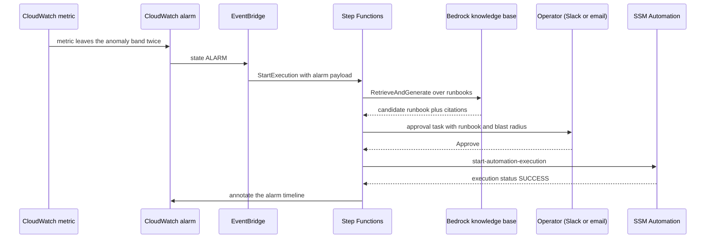
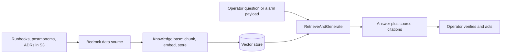

# 05 · AIOps and AI-Powered Infrastructure

> **Phase 9 — Cutting-Edge AWS** · Lesson 05 of 06
> ⬅️ Previous: [Graviton and Sustainability](./04-graviton-and-sustainability.md) · ➡️ Next: [Project: Cutting-Edge Lab](./06-project-cutting-edge-lab.md) · 🏠 [Phase overview](./README.md)

## 🎯 Learning Objectives

By the end of this lesson you will be able to:

- Separate the three AIOps capabilities — detection, diagnosis, and remediation — and judge each one honestly
- Configure CloudWatch metric and log anomaly detection, and predictive scaling, with working CLI commands
- Build a retrieval-augmented operational assistant over your own runbooks with Amazon Bedrock
- Design an automated remediation loop with blast-radius controls and a human approval gate
- Explain what happened to Amazon DevOps Guru and what replaced it

**Estimated time:** 85 min · **Difficulty:** Advanced

---

## 🧠 Core Concepts

**AIOps** is the application of machine learning and AI to operational data — metrics, logs, traces, events, tickets, and changes — with three distinct goals that vendors routinely blur together:

1. **Detection.** "Something is different from normal." This is genuinely solved. Statistical and ML baselines beat static thresholds for anything with daily or weekly seasonality.
2. **Diagnosis.** "Here is what caused it." This is partially solved. Correlation across metrics and recent changes is tractable; true causation in a distributed system is not.
3. **Remediation.** "Here is what we did about it." This is where AI is least reliable and where the consequences of being wrong are largest, which is why production remediation should be deterministic, versioned, and reversible — with AI proposing and machines or humans disposing.

Almost every disappointment with AIOps comes from buying capability 3 while needing capability 1.

### The state of AWS's AIOps portfolio (October 2026)

**Amazon DevOps Guru** analyzed CloudWatch metrics, traces, RDS Performance Insights, and CloudFormation stacks with ML to produce *reactive insights* (an anomaly in progress) and *proactive insights* (a resource that is trending toward a problem), with recommendations attached. It is being retired: **it stops accepting new customers on 29 October 2026 and reaches end of support on 30 September 2027**, after which the console, the API, and its CloudFormation resource types are withdrawn. Existing customers can keep using it, but if you are designing something today, it is not a building block.

AWS's stated migration path is two-pronged: move **metric anomaly detection and alerting to Amazon CloudWatch**, and move **AI-assisted operational investigation and insight enrichment to AWS DevOps Agent**, which monitors your infrastructure, performs automated root cause analysis on operational events, runs remediation procedures, and configures preventive measures. For anything you built on the DevOps Guru API — dashboards, ticketing integrations, IaC stacks referencing `AWS::DevOpsGuru::ResourceCollection` or `AWS::DevOpsGuru::NotificationChannel` — plan the migration before end of support, because a single withdrawn resource type can block an entire stack operation.

**Amazon CloudWatch** is the durable foundation, and it now covers most of what DevOps Guru did:

| Capability | What it does | Realistic limitation |
|-----------|--------------|----------------------|
| Metric anomaly detection | Learns a band per metric, including seasonal patterns | Needs history; new metrics are blind for days |
| Log anomaly detection | Flags unusual log *patterns* per log group | Not a root cause analyzer; noisy on variable text |
| Composite alarms | Alarms on alarms, cutting alert fatigue | Still threshold-based |
| Application Signals | SLOs and service-level views across services | Coverage depends on instrumentation |
| Contributor Insights | Which entities dominate a metric or log stream | Needs a defined rule; not generative |
| Metrics Insights | SQL-like queries across metrics at scale | A query engine, not a model |

**Predictive scaling** in EC2 Auto Scaling forecasts load from history (it wants at least a day or two of data, and improves over about two weeks) and provisions capacity ahead of the curve. It is not AIOps in the marketing sense — it is a forecast with a safety buffer — but it is one of the few "AI" features that reliably reduces both latency and cost, because scaling *before* the spike avoids paying for a slow ramp and over-provisioning.

In the security plane, ML has been standard for years: **GuardDuty** scores behavioral anomalies against threat intelligence, **Detective** builds a behavior graph for investigation, **Security Hub** normalizes and correlates findings into a common format, **Macie** classifies sensitive data, and **IAM Access Analyzer** generates least-privilege policies from observed CloudTrail activity. These are AIOps-adjacent and worth treating as one detection fabric rather than five tools.

### Generative AI for operations

The genuinely new capability is a **retrieval-augmented** assistant that answers "what does our runbook say about this alarm?" using *your* documents. Amazon Bedrock Knowledge Bases handles the ingestion, chunking, embedding, and vector storage; `RetrieveAndGenerate` returns an answer with citations to the source chunks. Point it at runbooks, incident postmortems, architecture decision records, and service catalog entries, and you have an assistant that knows your environment rather than one that knows the internet.

Two rules keep this useful rather than dangerous: always return **citations** so an operator can verify the claim, and never let the model execute the remediation. Let it draft the change; require the same review you would require of a junior engineer.

### Where AIOps still needs humans

- **Novel failure modes.** Anomaly detection is trained on what has happened. A first-of-its-kind outage looks like nothing, and therefore looks fine.
- **Business context.** A latency increase during a flash sale is not an incident. No metric-based model knows your launch calendar.
- **Change correlation.** Most incidents follow a deployment or a config change. If your change feed is not in the model, diagnosis will be guesswork.
- **Accountability.** Automated remediation needs an owner for the case where it makes things worse.
- **Data quality.** Baselines built on noisy metrics produce confident, wrong bands — worse than a threshold you understand.
- **Cost and drift.** Models need retraining and re-baselining as workloads change, and every retained data stream costs money.

---

## 🗺️ Architecture Diagram

The operational loop, with the honest division of labor between model and human:



How the pieces map onto the three AIOps capabilities, so you never buy diagnosis expecting detection:



An alert that reaches a fix with a human in the loop for anything risky:



The retrieval-augmented flow that keeps answers grounded in your own documents:



---

## 🧪 Hands-on Lab: Build an AIOps Loop with a Real Approval Gate

**Goal:** Detect an anomaly without a static threshold, ground the response in your own runbooks with Bedrock, and execute remediation only after a human approves.

**Prerequisites:**

- An AWS account with a workload that emits CloudWatch metrics and logs (an EC2 instance or an ECS service is enough)
- CLI v2, plus permissions for CloudWatch, Logs, Auto Scaling, Bedrock, Step Functions, SSM, and IAM
- At least one week of metric history for the metric you want to model
- Model access enabled in Amazon Bedrock for a foundation model available in your Region
- A handful of runbooks in Markdown in an S3 prefix

### Step 1 — Replace a static alarm with an anomaly band

```bash
# Teach CloudWatch what "normal" looks like for this metric
aws cloudwatch put-anomaly-detector \
  --namespace AWS/EC2 \
  --metric-name CPUUtilization \
  --stat Average \
  --dimensions Name=InstanceId,Value=i-0123456789abcdef0

# Alarm on the band, not on a fixed number. ANOMALY_DETECTION_BAND(m1, 2) = two standard deviations.
aws cloudwatch put-metric-alarm \
  --alarm-name ec2-cpu-anomaly \
  --comparison-operator LessThanLowerOrGreaterThanUpperThreshold \
  --evaluation-periods 2 \
  --datapoints-to-alarm 2 \
  --threshold-metric-id ad1 \
  --alarm-actions arn:aws:sns:eu-west-1:123456789012:ops-alerts \
  --metrics '[
    {"Id":"m1","ReturnData":false,"MetricStat":{"Metric":{"Namespace":"AWS/EC2","MetricName":"CPUUtilization","Dimensions":[{"Name":"InstanceId","Value":"i-0123456789abcdef0"}]},"Period":300,"Stat":"Average"}},
    {"Id":"ad1","Expression":"ANOMALY_DETECTION_BAND(m1,2)","Label":"CPUUtilization band"}
  ]'
```

### Step 2 — Add log anomaly detection on the application log group

```bash
# Flag unusual log patterns rather than unusual counts
aws logs create-log-anomaly-detector \
  --detector-name orders-api-log-anomalies \
  --log-group-arn-list arn:aws:logs:eu-west-1:123456789012:log-group:/ecs/orders-api \
  --evaluation-frequency PT5M \
  --anomaly-visibility-time PT30M \
  --filter-pattern "" \
  --kms-key-id alias/logs-anomaly

# Confirm it is training, then list detectors
aws logs list-log-anomaly-detectors
```

### Step 3 — Turn on predictive scaling for the service tier

```json
{
  "MetricSpecifications": [
    {
      "TargetValue": 55.0,
      "PredefinedMetricPairSpecification": { "PredefinedMetricType": "ASGCPUUtilization" }
    }
  ],
  "Mode": "ForecastAndScale",
  "SchedulingBufferTime": 900
}
```

```bash
# ForecastAndScale provisions ahead of the predicted curve; SchedulingBufferTime adds 15 min of headroom
aws autoscaling put-scaling-policy \
  --auto-scaling-group-name web-tier-asg \
  --policy-name web-tier-predictive \
  --policy-type PredictiveScaling \
  --predictive-scaling-configuration file://predictive.json

# ForecastOnly first is the safer rollout: watch the forecast before you trust it with capacity
```

### Step 4 — Ground an assistant in your runbooks

```json
{
  "name": "ops-runbooks",
  "roleArn": "arn:aws:iam::123456789012:role/BedrockKnowledgeBaseRole",
  "knowledgeBaseConfiguration": {
    "type": "VECTOR",
    "vectorKnowledgeBaseConfiguration": {
      "embeddingModelArn": "arn:aws:bedrock:eu-west-1::foundation-model/amazon.titan-embed-text-v2:0"
    }
  },
  "storageConfiguration": {
    "type": "OPENSEARCH_SERVERLESS",
    "opensearchServerlessConfiguration": {
      "collectionArn": "arn:aws:aoss:eu-west-1:123456789012:collection/abcdef0123456789",
      "vectorIndexName": "runbooks",
      "fieldMapping": {
        "vectorField": "embedding",
        "textField": "text",
        "metadataField": "metadata"
      }
    }
  }
}
```

```bash
# Create the knowledge base and a data source pointing at your runbook prefix
aws bedrock-agent create-knowledge-base --cli-input-json file://kb.json
aws bedrock-agent create-data-source \
  --knowledge-base-id <kb-id> \
  --name runbooks-s3 \
  --data-source-configuration '{"type":"S3","s3Configuration":{"bucketArn":"arn:aws:s3:::ops-runbooks-123456789012","inclusionPrefixes":["runbooks/"]}}'

# Ingest: chunk, embed, index
aws bedrock-agent start-ingestion-job --knowledge-base-id <kb-id> --data-source-id <ds-id>

# Ask a grounded question and get citations back
aws bedrock-agent-runtime retrieve-and-generate \
  --input '{"text":"What is the documented procedure when EC2 CPU utilization leaves the anomaly band on the web tier?"}' \
  --retrieve-and-generate-configuration '{"type":"KNOWLEDGE_BASE","knowledgeBaseConfiguration":{"knowledgeBaseId":"<kb-id>","modelArn":"arn:aws:bedrock:eu-west-1::foundation-model/anthropic.claude-3-5-sonnet-20240620-v1:0"}}' \
  --region eu-west-1
```

### Step 5 — Wire remediation behind an approval gate

```bash
# Route the alarm into a state machine rather than straight into an action
aws events put-rule \
  --name aiops-anomaly-loop \
  --event-pattern '{"source":["aws.cloudwatch"],"detail-type":["CloudWatch Alarm State Change"],"detail":{"state":{"value":["ALARM"]},"alarmName":["ec2-cpu-anomaly"]}}'

aws events put-targets --rule aiops-anomaly-loop \
  --targets '[{"Id":"start-workflow","Arn":"arn:aws:states:eu-west-1:123456789012:stateMachine:aiops-remediation","RoleArn":"arn:aws:iam::123456789012:role/EventBridgeInvokeRole"}]'
```

The state machine definition, with a callback task for human approval and a deterministic SSM runbook for the action:

```json
{
  "StartAt": "AskRunbooks",
  "States": {
    "AskRunbooks": {
      "Type": "Task",
      "Resource": "arn:aws:states:::lambda:invoke",
      "Parameters": { "FunctionName": "ops-rag-answer", "Payload.$": "$" },
      "ResultPath": "$.answer",
      "Next": "Approve"
    },
    "Approve": {
      "Type": "Task",
      "Resource": "arn:aws:states:::sns:waitForTaskToken",
      "Parameters": {
        "TopicArn": "arn:aws:sns:eu-west-1:123456789012:ops-approvals",
        "Message.$": "$.answer"
      },
      "Next": "Remediate",
      "TimeoutSeconds": 3600
    },
    "Remediate": {
      "Type": "Task",
      "Resource": "arn:aws:states:::aws-sdk:ssm:startAutomationExecution",
      "Parameters": {
        "DocumentName": "AWS-RestartEC2Instance",
        "Parameters": { "InstanceId": ["i-0123456789abcdef0"] }
      },
      "Next": "Done"
    },
    "Done": { "Type": "Succeed" }
  }
}
```

```bash
# The runbook itself is versioned and reviewable - this is the "deterministic" part
aws ssm start-automation-execution \
  --document-name AWS-RestartEC2Instance \
  --parameters InstanceId=i-0123456789abcdef0 \
  --max-concurrency 1 --max-errors 0
```

### Step 6 — Verify

```bash
# Confirm the detector learned a band and is producing values
aws cloudwatch get-metric-data --metric-data-queries '[
  {"Id":"band","Expression":"ANOMALY_DETECTION_BAND(m1,2)",
   "MetricStat":{"Metric":{"Namespace":"AWS/EC2","MetricName":"CPUUtilization"},"Period":300,"Stat":"Average"}}
]' --start-time "$(date -u -v-6H +%Y-%m-%dT%H:%M:%SZ)" --end-time "$(date -u +%Y-%m-%dT%H:%M:%SZ)"

# Force the alarm by driving load, then watch the workflow
aws cloudwatch set-alarm-state --alarm-name ec2-cpu-anomaly --state-value ALARM \
  --state-reason "manual test of the remediation loop"

aws stepfunctions list-executions \
  --state-machine-arn arn:aws:states:eu-west-1:123456789012:stateMachine:aiops-remediation --max-results 5

# Confirm the automation ran and is auditable
aws ssm describe-automation-executions --filters Key=DocumentName,Values=AWS-RestartEC2Instance
```

Success looks like: an anomaly band that tracks daily seasonality instead of a flat line, an alarm that fires on the band, a retrieval answer that cites a specific runbook file, an approval step that blocks execution until a human replies, and an SSM automation execution visible in the audit trail.

---

## 💻 CLI Reference

```bash
# Detection
aws cloudwatch put-anomaly-detector --namespace AWS/Lambda --metric-name Errors \
  --stat Sum --dimensions Name=FunctionName,Value=orders-handler
aws cloudwatch describe-anomaly-detectors --namespace AWS/Lambda --metric-name Errors
aws logs create-log-anomaly-detector --detector-name <name> --log-group-arn-list <arn> \
  --evaluation-frequency PT5M --filter-pattern ""
aws logs list-log-anomaly-detectors

# Diagnosis inputs
aws guardduty list-findings --detector-id <detector-id>
aws guardduty get-findings --detector-id <detector-id> --finding-ids <id>
aws securityhub get-findings --filters '{"SeverityLabel":[{"Value":"HIGH","Comparison":"EQUALS"}]}'
aws cloudwatch describe-alarms --state-value ALARM
aws cloudwatch get-metric-data --metric-data-queries file://queries.json --start-time <t> --end-time <t>

# Capacity foresight
aws autoscaling put-scaling-policy --auto-scaling-group-name <asg> --policy-name <name> \
  --policy-type PredictiveScaling --predictive-scaling-configuration file://predictive.json

# Generative assistance grounded in your documents
aws bedrock-agent list-knowledge-bases
aws bedrock-agent start-ingestion-job --knowledge-base-id <kb> --data-source-id <ds>
aws bedrock-agent-runtime retrieve-and-generate --input '{"text":"..."}' \
  --retrieve-and-generate-configuration file://rag.json

# Remediation
aws ssm start-automation-execution --document-name AWS-RestartEC2Instance --parameters <k=v>
aws ssm describe-automation-executions --filters Key=DocumentName,Values=<doc>
aws stepfunctions start-execution --state-machine-arn <arn> --input file://event.json
```

| Command | Purpose |
|---------|---------|
| `put-anomaly-detector` | Learn a baseline for one metric |
| `create-log-anomaly-detector` | Flag unusual log patterns per log group |
| `put-scaling-policy --policy-type PredictiveScaling` | Provision capacity ahead of forecast load |
| `retrieve-and-generate` | Answer an operational question with citations |
| `start-automation-execution` | Run a versioned, reviewable remediation runbook |
| `get-findings` (GuardDuty, Security Hub) | Feed security detections into the same loop |

---

## ✅ Best Practices

| Practice | Why it matters |
|----------|----------------|
| Reserve AI for detection and correlation; keep remediation deterministic | A wrong fix at 03:00 is worse than a paged human |
| Always require a minimum evaluation history before trusting a band | Detectors with days of data produce false bands |
| Start predictive scaling in `ForecastOnly` mode | You learn whether the forecast is credible before it moves capacity |
| Attach citations to every AI answer | Operators cannot audit an uncited claim |
| Make every automated action idempotent | EventBridge retries, and so do humans |
| Cap blast radius explicitly (`--max-concurrency`, `--max-errors`) | Prevents a loop from restarting an entire fleet |
| Keep the change feed in the model's context | Most incidents follow a deployment; include it in the alarm payload |
| Do not build new integrations on DevOps Guru | It stops accepting new customers on 29 October 2026 |
| Review detector precision monthly | Silent false positives destroy trust in the whole loop |
| Retire detectors for deleted resources | Orphan detectors keep costing money and generating noise |

---

## ⚠️ Common Pitfalls

| Pitfall | Symptom | Fix |
|---------|---------|-----|
| Expecting anomaly detection to find root cause | "It alerted but did not tell me why" | Add correlation with changes and a retrieval assistant |
| Building on retiring services | DevOps Guru resources fail in CloudFormation after end of support | Migrate detection to CloudWatch and investigation to DevOps Agent |
| Training a detector on seasonal data with too little history | Bands that alarm every night at the same time | Wait for at least a weekly cycle, or set `ExcludedTimeRanges` |
| Auto-remediating without a gate | A noisy detector restarts production repeatedly | Put a Step Functions approval state in front of the action |
| Running a RAG assistant without chunk quality controls | Confident answers citing an obsolete runbook | Version documents, re-ingest on change, show citations |
| Ignoring guardrails on generated content | Assistant outputs operational advice you cannot justify | Use Bedrock Guardrails and constrain the answer format |
| Indexing everything | High ingestion cost and diluted retrieval | Index runbooks, postmortems, and ADRs, not the whole wiki |
| Letting log anomaly detection cover a noisy log group | Constant findings, all ignored | Scope detectors to application logs with stable structure |
| No owner for the remediation workflow | Nobody can answer why it ran last Tuesday | Tag the state machine with an owning team and on-call rotation |

---

## 💰 Cost Considerations

The AIOps bill has three components, and the middle one is the surprise:

- **Detection.** CloudWatch anomaly detectors are billed per metric per month, which is trivial for a handful of metrics and non-trivial at thousands. Log anomaly detection is billed per GB scanned at the evaluation frequency, so a chatty log group evaluated every 5 minutes can cost more than the application's compute. Composite alarms are cheap and reduce downstream cost by suppressing duplicate notifications.
- **Retrieval.** A Bedrock knowledge base bills for ingestion (embedding tokens), the vector store (OpenSearch Serverless charges by minimum OCU, which is an always-on cost even with zero queries), and per-query charges for `RetrieveAndGenerate`. The vector store's floor is the part people forget; if your runbook corpus is small, a managed vector store may be disproportionate.
- **Generation.** Foundation model tokens, priced per input and output token, with a large gap between cheap models and frontier models. An assistant that operates a 20,000-token context on every query is an order of magnitude more expensive than one that retrieves three chunks.

Predictive scaling is unusual in that it **saves** money: provisioning ahead of a forecast lets you hold closer to the minimum capacity because you are not paying for an over-provisioned static fleet. The same is true of good anomaly detection, which replaces blunt thresholds that keep expensive headroom.

The most expensive AIOps mistake is not the tooling — it is the trust cost. A detector with poor precision gets muted, and then a real incident goes unnoticed.

---

## 🔐 Security Considerations

- **Operational data is sensitive.** Metrics and logs reveal architecture, customer identifiers, and sometimes credentials. Scope IAM so the anomaly detectors, RAG index, and assistant see only what they need.
- **Treat the assistant as an untrusted reader.** Retrieved documents can contain injected instructions. Use Bedrock Guardrails, restrict the model's tools to none, and never let retrieved text trigger actions.
- **The remediation role is a high-value credential.** A Lambda or state machine that can restart instances can also stop them. Grant the narrowest action set, use resource-level conditions, and require approval for anything with `Terminate` in the name.
- **Separate the detector from the acted-upon accounts.** For multi-account setups, keep remediation roles as cross-account roles with external IDs, and log every assumption.
- **Annotations are an audit surface.** CloudWatch alarm annotations and Step Functions execution history are your evidence of what the loop decided and when — enable them deliberately and retain accordingly.
- **Do not put secrets or customer data into model prompts.** Retrieval over an index that inadvertently includes `.env` files or database dumps is a data exfiltration path. Curate the data source, and add an ingestion filter.
- **Guard the approval channel.** The human approval step is only as strong as the channel that approves it. Authenticate it (for example with an interactive callback that verifies the operator), and log the approver identity.
- **Retire DevOps Guru safely.** Export existing insights before 30 September 2027 if you need the history, and remove `AWS::DevOpsGuru::*` resources from IaC so a future stack update does not fail.

---

## 🧩 Exercise

Take one production-shaped alarm in your environment and rebuild it as an anomaly detector. Then write a runbook for it in Markdown, ingest that runbook into a Bedrock knowledge base, and build a Step Functions workflow that asks the knowledge base for the documented procedure and waits for approval before running an SSM Automation document.

Success looks like: a detector with fewer false positives than the threshold it replaced over a one-week window, a `RetrieveAndGenerate` response containing a citation to the exact runbook file, and one completed workflow execution whose history shows the approval timestamp and the automation execution ID.

---

## 📚 Resources

- [Amazon CloudWatch anomaly detection](https://docs.aws.amazon.com/AmazonCloudWatch/latest/monitoring/CloudWatch_Anomaly_Detection.html)
- [CloudWatch Logs anomaly detection](https://docs.aws.amazon.com/AmazonCloudWatch/latest/logs/LogsAnomalyDetection.html)
- [Predictive scaling for EC2 Auto Scaling](https://docs.aws.amazon.com/autoscaling/ec2/userguide/ec2-auto-scaling-predictive-scaling.html)
- [Amazon DevOps Guru end of support](https://docs.aws.amazon.com/devops-guru/latest/userguide/devops-guru-end-of-support.html)
- [AWS DevOps Agent](https://docs.aws.amazon.com/devopsagent/)
- [Amazon Bedrock Knowledge Bases](https://docs.aws.amazon.com/bedrock/latest/userguide/knowledge-base.html)
- [AWS Systems Manager Automation](https://docs.aws.amazon.com/systems-manager/latest/userguide/systems-manager-automation.html)
- [AWS Well-Architected Operational Excellence Pillar](https://docs.aws.amazon.com/wellarchitected/latest/operational-excellence-pillar/welcome.html)

---

## ➡️ Next Steps

You now have every ingredient for the phase capstone: a quantum experiment, an ARM64 migration, an AIOps loop, and a satellite downlink path. The final lesson assembles them into one architecture — and, more importantly, into a cost/benefit table that says which parts of it you should not build yet.

> ⬅️ Previous: [Graviton and Sustainability](./04-graviton-and-sustainability.md) · ➡️ Next: [Project: Cutting-Edge Lab](./06-project-cutting-edge-lab.md) · 🏠 [Phase overview](./README.md)
