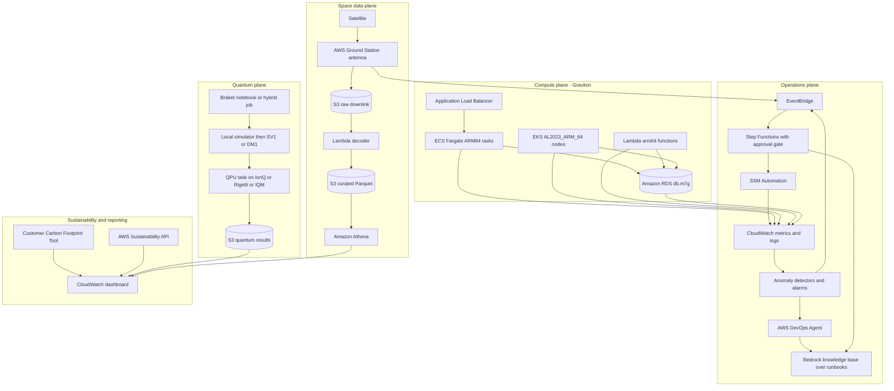
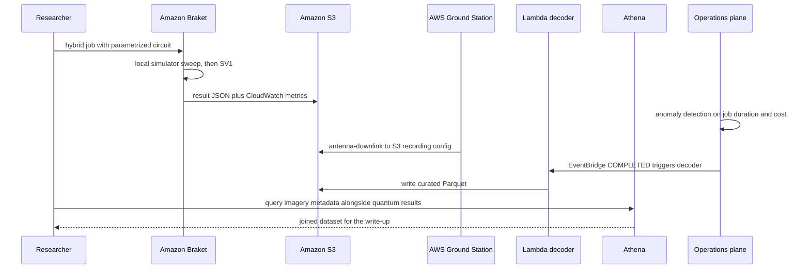
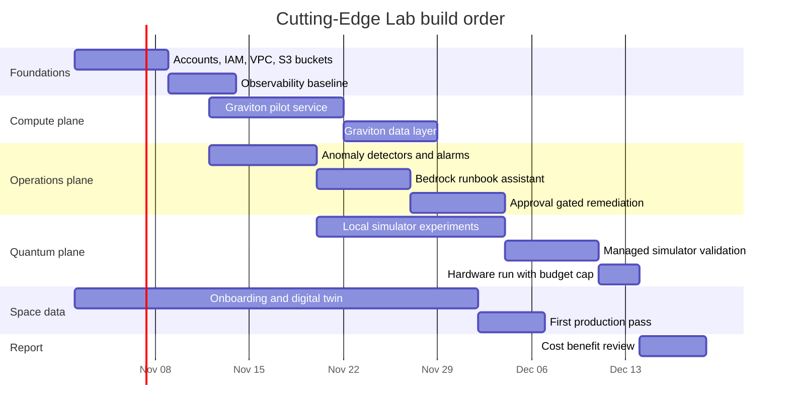

# 06 · Project: Cutting-Edge Lab

> **Phase 9 — Cutting-Edge AWS** · Lesson 06 of 06
> ⬅️ Previous: [AIOps and AI-Powered Infrastructure](./05-aiops-and-ai-powered-infrastructure.md) · ➡️ Next: [Phase 10 — Grandmaster Projects](../phase-10-grandmaster-projects/README.md) · 🏠 [Phase overview](./README.md)

## 🎯 Learning Objectives

By the end of this lesson you will be able to:

- Combine quantum, space-data, ARM64, and AIOps concerns into one coherent architecture
- Draw the four planes of the lab and explain every arrow
- Produce a cost/benefit table that recommends *against* building things you do not need
- Defend the design in a review with an explicit list of assumptions and kill criteria

**Estimated time:** 4–6 hours · **Difficulty:** Advanced

---

## 🧠 Core Concepts

### The scenario

You are the platform lead for a small advanced-projects team. A research partner has:
- a quantum chemistry hypothesis they want tested on real hardware, but they have no budget for blind hardware runs
- a fleet of imaging satellites whose downlink data currently lands in a vendor's portal, not in your data lake
- a growing container estate running on x86 with no clear reason
- an on-call rotation that is drowning in static-threshold alarms

Your job is **one lab environment** that serves all four, proves value quickly, and can be shut down cleanly. This is the defining skill of a senior architect: not building the most impressive system, but building the smallest system that answers the questions being asked.

### The four planes

The lab separates into four planes that share identity, networking, and observability but have independent lifecycles. That separation is what makes it buildable by one team.

| Plane | Purpose | Primary services | Lifecycle |
|-------|---------|------------------|-----------|
| **Quantum** | Test a hypothesis on simulators, then validate on hardware | Amazon Braket, S3, CloudWatch | Burst, weeks |
| **Space data** | Ingest downlink into the data lake | AWS Ground Station, S3, Lambda, Athena, Glue | Continuous, mission-length |
| **Compute** | Run steady-state workloads efficiently | ECS/EKS on Graviton, Lambda `arm64`, RDS `db.m7g` | Continuous, long-lived |
| **Operations** | Detect, diagnose, remediate, and report | CloudWatch, AWS DevOps Agent, Bedrock, EventBridge, Step Functions, SSM | Continuous, permanent |

### Naming the AIOps plane honestly

This lab includes an AIOps workstream. If you were designing it in 2024 you would have reached for Amazon DevOps Guru. In October 2026 that is the wrong choice: **DevOps Guru stops accepting new customers on 29 October 2026 and reaches end of support on 30 September 2027.** So the design uses CloudWatch metric and log anomaly detection for detection and **AWS DevOps Agent** for investigation, with a retrieval-augmented assistant over runbooks for the "what does our procedure say" step. DevOps Guru appears in the design only as a migration note for anyone who already has it.

### The four planes

## 🗺️ Architecture Diagram

The full lab. Four planes, one shared foundation of identity, network, and observability:



The sequence for the two flagship flows — a quantum experiment and a satellite pass — showing that they share only S3, IAM, and observability:



How the work is sequenced, because parallel tracks on one team is how projects slip:



---

## 🧪 Hands-on Lab: Assemble the Lab

**Goal:** Stand up all four planes in one account with a shared foundation, prove each plane works, and produce the cost/benefit review.

**Prerequisites:** everything from lessons 01–05 — a Braket-enabled account, a Ground Station satellite onboarded (or digital-twin onboarding), a VPC with private subnets, a container image in ECR, and a Bedrock model enabled.

### Step 1 — Lay the shared foundation

```bash
# One bucket per plane, so lifecycle policy and access can differ
aws s3api create-bucket --bucket lab-quantum-results-123456789012 --region eu-west-1 \
  --create-bucket-configuration LocationConstraint=eu-west-1
aws s3api create-bucket --bucket lab-downlink-raw-123456789012 --region eu-west-1 \
  --create-bucket-configuration LocationConstraint=eu-west-1
aws s3api create-bucket --bucket lab-curated-123456789012 --region eu-west-1 \
  --create-bucket-configuration LocationConstraint=eu-west-1

# Block public access on all of them, then encrypt with your own key
for b in lab-quantum-results-123456789012 lab-downlink-raw-123456789012 lab-curated-123456789012; do
  aws s3api put-public-access-block --bucket "$b" \
    --public-access-block-configuration BlockPublicAcls=true,IgnorePublicAcls=true,BlockPublicPolicy=true,RestrictPublicBuckets=true
done

# Budget guardrail before anything can spend money
aws budgets create-budget --account-id 123456789012 --budget file://lab-budget.json --notifications-with-subscribers file://lab-budget-alerts.json
```

### Step 2 — Compute plane: one Graviton service, end to end

```bash
# Multi-arch image so the same tag works on x86 and ARM64 nodes
docker buildx build --platform linux/amd64,linux/arm64 \
  -t 123456789012.dkr.ecr.eu-west-1.amazonaws.com/lab-api:1.0.0 --push .

# ARM64 Fargate service as the pilot, keeping the x86 service for A/B comparison
aws ecs register-task-definition --cli-input-json file://lab-api-arm64.json
aws ecs create-service --cluster lab --service-name lab-api-arm64 \
  --task-definition lab-api --desired-count 2 \
  --launch-type FARGATE \
  --network-configuration 'awsvpcConfiguration={subnets=[subnet-0abc123def4567890],securityGroups=[sg-0abc123def4567890],assignPublicIp=DISABLED}'

# ARM64 Lambda for the event handlers
aws lambda update-function-configuration --function-name lab-events --architectures arm64

# Graviton database instance class
aws rds modify-db-instance --db-instance-identifier lab-db \
  --db-instance-class db.m7g.large --apply-immediately
```

### Step 3 — Quantum plane: simulate, then spend

```python
# lab_vqe.py - the shape of a budgeted experiment
from braket.aws import AwsDevice
from braket.devices import LocalSimulator
from braket.jobs import save_job_result
from braket.jobs.metrics import log_metric
from braket.circuits import Circuit, FreeParameter

def ansatz(theta):
    return Circuit().rx(0, theta).ry(1, theta / 2).cnot(0, 1)

# 1. Sweep on the free local simulator
local = LocalSimulator()
for theta in [0.1, 0.5, 1.0, 1.5]:
    counts = local.run(ansatz(theta).probability(), shots=500).result().values[0].value
    log_metric("energy_local", float(counts[0]), iteration=int(theta * 10))

# 2. Validate on the managed simulator
sv1 = AwsDevice("arn:aws:braket:::device/quantum-simulator/amazon/sv1")
task = sv1.run(ansatz(0.5).probability(), shots=2000,
              s3_destination_folder=("lab-quantum-results-123456789012", "sv1"))
log_metric("energy_sv1", float(task.result().values[0].value[0]))

# 3. Only then submit a small hardware run, and record its cost in the results
qpu = AwsDevice("arn:aws:braket:eu-north-1::device/qpu/iqm/Garnet")
hw = qpu.run(ansatz(0.5), shots=100,
             s3_destination_folder=("lab-quantum-results-123456789012", "qpu"))
save_job_result({"hardware_task": hw.id, "device": qpu.arn})
```

```bash
# Cap the spend before submitting: stopping conditions are the budget control
aws braket create-job \
  --job-name lab-vqe-budgeted \
  --role-arn arn:aws:iam::123456789012:role/BraketExecutionRole \
  --algorithm-specification '{"scriptModeConfig":{"entryPoint":"lab_vqe.py","s3Uri":"s3://lab-quantum-results-123456789012/code/","compressionType":"NONE"},"containerImage":{"uri":"123456789012.dkr.ecr.eu-west-1.amazonaws.com/amazon-braket-base-v1.0:latest"}}' \
  --instance-config '{"instanceType":"ml.m5.xlarge"}' \
  --output-data-config '{"s3Path":"s3://lab-quantum-results-123456789012/jobs/","kmsKeyId":"alias/lab-results"}' \
  --device-config '{"deviceArn":"arn:aws:braket:::device/quantum-simulator/amazon/sv1"}' \
  --stopping-condition '{"maxRuntimeInSeconds":3600}'
```

### Step 4 — Space data plane: digital twin first, then production

```bash
# Build and validate the mission profile against the digital twin: no spectrum licensing needed
aws groundstation create-config --name lab-s3-recording \
  --config-data '{"s3RecordingConfig":{"bucketArn":"arn:aws:s3:::lab-downlink-raw-123456789012","roleArn":"arn:aws:iam::123456789012:role/GroundStationS3RecordingRole","prefix":"imagery/"}}' \
  --region eu-west-1

aws groundstation create-mission-profile \
  --name lab-xband-downlink \
  --tracking-config-arn arn:aws:groundstation:eu-west-1:123456789012:config/tracking/11111111-2222-3333-4444-555555555555 \
  --dataflow-edges '[["arn:aws:groundstation:eu-west-1:123456789012:config/antenna-downlink/11111111-2222-3333-4444-555555555555","arn:aws:groundstation:eu-west-1:123456789012:config/s3-recording/66666666-7777-8888-9999-000000000000"]]' \
  --minimum-viable-contact-duration-seconds 180 \
  --contact-pre-pass-duration-seconds 300 \
  --region eu-west-1

# Reserve against a digital twin ground station until the production onboarding completes
aws groundstation reserve-contact \
  --mission-profile-arn arn:aws:groundstation:eu-west-1:123456789012:mission-profile/aaaaaaaa-bbbb-cccc-dddd-eeeeeeeeeeee \
  --satellite-arn arn:aws:groundstation::123456789012:satellite/11111111-2222-3333-4444-555555555555 \
  --ground-station "Digital Twin Ireland 1" \
  --start-time "2026-11-20T09:00:00Z" --end-time "2026-11-20T09:07:20Z" \
  --region eu-west-1
```

```bash
# Decode when the pass completes and land curated Parquet for Athena
aws events put-rule --name lab-gs-completed \
  --event-pattern '{"source":["aws.groundstation"],"detail-type":["Ground Station Contact State Change"],"detail":{"contactStatus":["COMPLETED"]}}'
aws events put-targets --rule lab-gs-completed \
  --targets '[{"Id":"decode","Arn":"arn:aws:lambda:eu-west-1:123456789012:function:lab-decode"},"RoleArn":"arn:aws:iam::123456789012:role/EventBridgeInvokeRole"}'
```

### Step 5 — Operations plane: detection, diagnosis, remediation, with a gate

```bash
# Detection: a band on the pilot service, plus log anomaly detection
aws cloudwatch put-anomaly-detector --namespace AWS/ECS --metric-name CPUUtilization \
  --stat Average --dimensions Name=ClusterName,Value=lab Name=ServiceName,Value=lab-api-arm64

aws logs create-log-anomaly-detector --detector-name lab-api-log-anomalies \
  --log-group-arn-list arn:aws:logs:eu-west-1:123456789012:log-group:/ecs/lab-api \
  --evaluation-frequency PT5M --filter-pattern ""

# Diagnosis: Ground Station and CloudWatch events feed one investigation surface
# Remediation: EventBridge to Step Functions, with an approval callback before SSM Automation
aws events put-rule --name lab-alarm-loop \
  --event-pattern '{"source":["aws.cloudwatch"],"detail-type":["CloudWatch Alarm State Change"],"detail":{"state":{"value":["ALARM"]}}}'
```

```bash
# The audit view that proves the loop worked
aws ssm describe-automation-executions --filters Key=DocumentName,Values=AWS-RestartEC2Instance
aws stepfunctions list-executions \
  --state-machine-arn arn:aws:states:eu-west-1:123456789012:stateMachine:lab-remediation --max-results 10
```

### Step 6 — Sustainability plane and the benefit review

```bash
# Baseline the footprint for the lab account
aws sustainability get-estimated-carbon-emissions --generate-cli-skeleton input > carbon-request.json
aws sustainability get-estimated-carbon-emissions --cli-input-json file://carbon-request.json --region us-east-1

# Compare cost before and after the Graviton pilot, grouped by instance type
aws ce get-cost-and-usage --time-period Start=2026-11-01,End=2026-12-01 --granularity DAILY \
  --metrics UnblendedCost --group-by Type=DIMENSION,Key=INSTANCE_TYPE
```

### Step 7 — Verify the whole lab

```bash
# Quantum: a completed job with results, and a hardware task id recorded
aws braket search-jobs --filters name=jobName,values=lab-vqe-budgeted
aws s3 ls s3://lab-quantum-results-123456789012/jobs/ --recursive | head

# Space: a completed contact and decoded objects in the curated bucket
aws groundstation list-contacts --status-list COMPLETED --region eu-west-1
aws s3 ls s3://lab-curated-123456789012/imagery/ --recursive | head

# Compute: ARM64 confirmed on the running task
aws ecs list-services --cluster lab

# Operations: a detector producing values, and one remediation execution with an approval
aws cloudwatch describe-anomaly-detectors --namespace AWS/ECS --metric-name CPUUtilization

# Reporting: emissions data returned, and a dashboard that renders
aws cloudwatch get-dashboard --dashboard-name lab-cutting-edge
```

Success looks like: all four planes producing artifacts in S3, one hardware quantum task whose cost you can state to the cent, one decoded satellite pass, one Graviton service running with measurable improvement, one automated remediation that required a human approval, and a dashboard that a non-engineer can read.

---

## 💻 CLI Reference

```bash
# Quantum plane
aws braket search-devices --filters name=deviceArn,values=<device-arn>
aws braket create-job --job-name <name> --cli-input-json file://job.json
aws braket get-job --job-arn <arn>

# Space data plane
aws groundstation list-ground-stations
aws groundstation reserve-contact --mission-profile-arn <arn> --satellite-arn <arn> \
  --ground-station "Ireland 1" --start-time <iso> --end-time <iso>
aws groundstation describe-contact --contact-id <id>

# Compute plane
aws ecs register-task-definition --cli-input-json file://arm64-task.json
aws eks create-nodegroup --ami-type AL2023_ARM_64_STANDARD --cluster-name lab
aws lambda update-function-configuration --function-name <fn> --architectures arm64

# Operations plane
aws cloudwatch put-anomaly-detector --namespace <ns> --metric-name <m> --stat Average
aws cloudwatch put-metric-alarm --comparison-operator LessThanLowerOrGreaterThanUpperThreshold
aws bedrock-agent-runtime retrieve-and-generate --input file://question.json --retrieve-and-generate-configuration file://rag.json
aws events put-rule --name <rule> --event-pattern file://pattern.json
aws ssm start-automation-execution --document-name AWS-RestartEC2Instance

# Governance and reporting
aws budgets describe-budgets --account-id 123456789012
aws sustainability get-estimated-carbon-emissions --cli-input-json file://carbon-request.json
aws ce get-cost-and-usage --time-period Start=2026-11-01,End=2026-12-01 --granularity DAILY --metrics UnblendedCost
```

| Command | Purpose |
|---------|---------|
| `braket create-job --stopping-condition` | Run a budgeted quantum experiment |
| `groundstation reserve-contact` | Buy a specific pass; use the digital twin while onboarding |
| `ecs register-task-definition` with `ARM64` | Run the compute plane on Graviton |
| `cloudwatch put-anomaly-detector` | Detect without static thresholds |
| `bedrock-agent-runtime retrieve-and-generate` | Answer operational questions from your own runbooks |
| `sustainability get-estimated-carbon-emissions` | Report emissions for the lab |

---

## ✅ Best Practices

| Practice | Why it matters |
|----------|----------------|
| Give every plane its own bucket and lifecycle policy | Quantum results, raw downlink, and curated data have different retention needs |
| Put a budget and a teardown date on every plane | Cutting-edge services have surprising unit economics |
| Build the digital-twin path before the production path | You can validate Ground Station integration with no licensing delay |
| Simulate before you spend in Braket | A hardware run costs orders of magnitude more than the same circuit locally |
| Keep one x86 service alive during the Graviton pilot | A/B comparison is the only credible evidence |
| Never let the AIOps loop act without a gate on anything destructive | Blast radius is the whole game |
| Annotate alarm timelines | Future you needs to know why the loop acted |
| Write the shutdown runbook in week one | Cutting-edge labs often end as zombie spend |
| Record assumptions next to every number in the cost table | Prices and services change; your reasoning should survive that |
| Do not build on retiring services | DevOps Guru stops accepting new customers on 29 October 2026 |

---

## ⚠️ Common Pitfalls

| Pitfall | Symptom | Fix |
|---------|---------|-----|
| Treating all four planes as one project | Nothing ships; each plane blocks the others | Ship the compute plane first, quantum and space on their own cadence |
| Underestimating Ground Station onboarding | Weeks or months with no data | Reserve effort for the questionnaire, licensing, and NDAs from day one |
| Submitting quantum hardware runs to "see if it works" | Hundreds of dollars for an algorithm that was never simulated | Gate every hardware run behind a simulation result |
| Forgetting the vector store floor cost | A RAG assistant costs more idle than in use | Check current OCU minimums; consider a smaller corpus or a different retrieval path |
| Measuring Graviton by hourly rate only | "It is cheaper" with worse p99 | Compare cost per successful request, not cost per hour |
| Building a remediation loop with no kill switch | A noisy detector causes repeated restarts | Step Functions approval state plus `--max-concurrency` |
| No teardown plan | The lab becomes permanent spend nobody owns | Budget action, scheduled teardown, and an owner tag on every resource |
| Ignoring the 3-month lag in carbon reporting | Numbers that do not reflect last week's change | Use the footprint tool for trend and your own cost data for the current month |
| One giant architecture diagram with no legend | Reviewers cannot tell what is built and what is planned | Mark built, planned, and deferred explicitly on the diagram |

---

## 💰 Cost Considerations

The table below is the deliverable that matters most. Treat the numbers as **illustrative orders of magnitude** for a small lab in one Region, and replace every one of them with a figure from your own pricing exercise. The verdict column is the actual output of the review.

| Component | Illustrative monthly run cost | Benefit | Verdict |
|-----------|-------------------------------|---------|---------|
| Braket local simulator | $0 | Unlimited iteration; catches most bugs | **Build** |
| Braket managed simulators (SV1/DM1, a few hours) | Single-digit to low tens of dollars | Validates circuits at real scale | **Build** |
| Braket QPU runs (10 tasks, ~1,000 shots each) | Tens to low hundreds of dollars, device-dependent | Validates the hypothesis on real hardware | **Build once, then pause** |
| Braket Hybrid Jobs (`ml.m5.xlarge`, a few hours) | Low tens of dollars | Encapsulates the experiment reproducibly | **Build** |
| Ground Station digital twin integration | No antenna time charge | Removes licensing delay from the critical path | **Build immediately** |
| Ground Station production contacts (for example 40 passes/month of short X-band downlinks) | Thousands of dollars, dominated by antenna minutes | Real mission data instead of a sample dataset | **Only with a funded mission** |
| S3 for raw and curated data | Low tens of dollars at lab volume | Cheap, durable, and queryable | **Build** |
| Graviton migration of the compute plane | Saves an estimated 10–30% on compute lines after engineering effort | Direct cost reduction plus lower energy per request | **Build** |
| CloudWatch anomaly detectors (about 200 metrics) | Low tens of dollars | Fewer false alarms than static thresholds | **Build** |
| Bedrock knowledge base (ingestion plus queries) | Tokens only, small at lab scale | Grounded answers in seconds instead of a Slack archaeology dig | **Build** |
| Bedrock vector store (managed, serverless) | Has a per-hour capacity floor that can reach the low hundreds of dollars per month even at zero traffic | Enables retrieval | **Prototype, then re-evaluate** — check current minimum capacity pricing |
| AWS DevOps Agent | Consumption-based | Root cause analysis on real events | **Build if you have incident volume** |
| Amazon DevOps Guru | n/a for new customers | — | **Do not build** — closed to new customers 29 October 2026, end of support 30 September 2027 |
| CloudWatch dashboards, EventBridge, Step Functions, SSM | Cents to low dollars | Makes the loop observable and auditable | **Build** |
| Customer Carbon Footprint Tool and Sustainability API | $0 | Reporting and Region-level decisions | **Build** |

**What drives the bill:** in this lab it is almost never the clever parts. Ground Station antenna minutes and the vector-store capacity floor dominate a realistic bill, while the quantum simulator work — the part that sounds most exotic — typically costs less than lunch. Re-run this table quarterly with real cost data, because the only thing more expensive than a cutting-edge lab is a cutting-edge lab nobody is measuring.

---

## 🔐 Security Considerations

- **Planes need separate roles, not one lab role.** A single broad role means a compromised decoder Lambda can also submit quantum tasks and modify remediation workflows. Use one role per plane with resource-scoped policies.
- **Encrypt every result.** Quantum results, downlink data, and curated Parquet all use customer-managed KMS keys so access can be revoked independently of bucket policy.
- **Uplink capability is the highest-risk permission in the lab.** If you add S-band uplink, isolate it in its own role and account, require MFA, and alert on every contact reservation that includes an uplink dataflow.
- **The remediation loop is the most dangerous component.** SNS approval topics should require authenticated subscriptions, and destructive SSM documents should never be reachable from an unattended path.
- **Retrieved documents can carry injected instructions.** Constrain the assistant with Bedrock Guardrails, do not attach action-capable tools, and always inspect citations before acting.
- **Ingest filters are a data-loss control.** A Bedrock data source pointed at a broad prefix will happily index `.env` files. Curate the prefix and review what was ingested.
- **Tag for cost and for ownership on the same pass.** `Project`, `Plane`, `Owner`, and `ExpiresOn` tags let you find and shut down unmanaged resources; they also make the security review tractable.
- **The lab must be destructible by design.** Write and test the teardown automation before you hand the lab to anyone else, and verify that it removes data, roles, and keys.

---

## 🧩 Exercise

Run the review, not the build. Take the architecture diagram above, mark every component as **built**, **planned**, or **deferred**, and then defend the deferred list in writing. For each deferred item, state the trigger that would move it to planned — a cost threshold, a customer commitment, a research result, or a service's general availability.

Then answer three questions in one page:

1. Which plane pays for itself, and by when?
2. Which plane is funded research, and what would make it stop being worth funding?
3. If you had to cut the lab to a single plane tomorrow, which one survives, and what breaks downstream?

Success looks like: a marked-up diagram, a deferred list with explicit triggers, and a one-page memo that a skeptical finance partner would accept — including the sentence "we should not build this yet" at least once.

---

## 📚 Resources

- [Amazon Braket Developer Guide](https://docs.aws.amazon.com/braket/latest/developerguide/what-is-braket.html)
- [AWS Ground Station User Guide](https://docs.aws.amazon.com/ground-station/latest/ug/aws-ground-station-antenna-locations.html)
- [AWS Graviton getting started](https://github.com/aws/aws-graviton-getting-started)
- [Amazon CloudWatch anomaly detection](https://docs.aws.amazon.com/AmazonCloudWatch/latest/monitoring/CloudWatch_Anomaly_Detection.html)
- [AWS DevOps Agent](https://docs.aws.amazon.com/devopsagent/)
- [Amazon Bedrock Knowledge Bases](https://docs.aws.amazon.com/bedrock/latest/userguide/knowledge-base.html)
- [AWS Well-Architected Framework](https://docs.aws.amazon.com/wellarchitected/latest/framework/welcome.html)
- [AWS Pricing Calculator](https://calculator.aws/)

---

## ➡️ Next Steps

You have now covered the whole frontier: quantum, robots, satellites, silicon, and AI-run operations — with the compromises stated openly. Phase 10 changes the nature of the work. Instead of learning one more service, you will design systems at Amazon's scale, break them deliberately, and hand the knowledge on.

> ⬅️ Previous: [AIOps and AI-Powered Infrastructure](./05-aiops-and-ai-powered-infrastructure.md) · ➡️ Next: [Phase 10 — Grandmaster Projects](../phase-10-grandmaster-projects/README.md) · 🏠 [Phase overview](./README.md)
