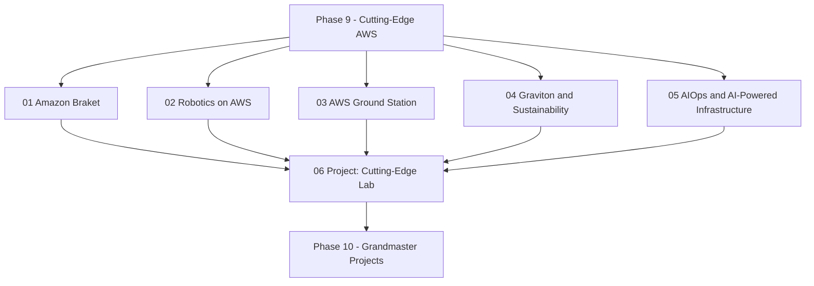

# Phase 9 — Cutting-Edge AWS

Phase 9 is where the roadmap stops optimizing yesterday's architecture and starts exploring the frontier: quantum computing, robotics, satellite ground stations, ARM-based silicon, and AI-driven operations. These are the services you will not be tested on by any certification exam — which is exactly why they are worth learning. They are also the services where vendor claims outrun reality, so this phase is deliberately blunt about what is generally available, what is in preview, and what has been retired.

This phase comes after Phase 8 because it assumes you can already design a production workload. The cutting-edge topics here are not "hello world" services; they are specialized control planes you attach to a solid foundation.

## Phase Goals

- Understand what quantum computing actually is in 2026 (the NISQ era) and when Amazon Braket is worth paying for
- Run robotics workloads in the cloud without a service that manages them end to end
- Ingest satellite downlink data from space into Amazon S3 using AWS Ground Station
- Cut cost and carbon by moving steady-state compute to AWS Graviton (ARM64)
- Separate real AIOps capability from marketing, and automate the part that is genuinely automatable
- Assemble all of it into one defensible architecture with an honest cost/benefit table

## Phase Map

## Lessons in this Phase

| # | Lesson | Focus | Difficulty |
|---|--------|-------|------------|
| 01 | [Amazon Braket](./01-amazon-braket.md) | Qubits, simulators vs QPUs, hybrid jobs, PennyLane/Qiskit, NISQ reality check | Intermediate |
| 02 | [Robotics on AWS](./02-aws-robomaker.md) | ROS 2 fundamentals, cloud simulation, Greengrass fleet management, the RoboMaker migration path | Intermediate |
| 03 | [AWS Ground Station](./03-aws-ground-station.md) | Ground station as a service, S-band/X-band, mission profiles, contacts, delivery to S3 | Advanced |
| 04 | [Graviton and Sustainability](./04-graviton-and-sustainability.md) | Graviton2-5, ARM64 migration, carbon footprint tooling, region selection | Intermediate |
| 05 | [AIOps and AI-Powered Infrastructure](./05-aiops-and-ai-powered-infrastructure.md) | Anomaly detection, predictive scaling, Bedrock assistants, automated remediation loops | Advanced |
| 06 | [Project: Cutting-Edge Lab](./06-project-cutting-edge-lab.md) | Capstone: Braket + Graviton + AIOps + Ground Station in one architecture | Advanced |

## Capstone Project

**Project: Cutting-Edge Lab** — design and partially build a single environment that combines a Braket experiment, a Graviton migration, an AIOps feedback loop, and a Ground Station downlink path into S3.

Deliverables:

- An architecture diagram showing the quantum, edge/space, compute, and observability planes and how they connect
- A reproducible Braket hybrid job that logs metrics into CloudWatch
- A Graviton migration plan for at least two compute services, with measured `arm64` vs `x86_64` timings
- An AIOps loop: anomaly detector → alarm → EventBridge → Lambda remediation → audit trail
- A Ground Station mission profile plan (locations, bands, dataflow to S3, IAM role) tested with the digital twin feature
- A cost/benefit table that states plainly which parts of the design are not worth the money yet

See [Lesson 06](./06-project-cutting-edge-lab.md) for the full brief.

## Phase Checklist

- [ ] I can explain the difference between a qubit, a classical bit, and a shot-based measurement
- [ ] I have run a circuit on the Braket local simulator and on a managed simulator
- [ ] I can name the current AWS Ground Station locations and bands supported at each
- [ ] I have migrated at least one workload to Graviton and measured the price-performance change
- [ ] I can distinguish metric anomaly detection from root cause analysis, and say which one AI does well
- [ ] I have reported my estimated carbon emissions for at least one month
- [ ] I can describe why AWS RoboMaker is not an option for new projects

## Phase Resources

- [Amazon Braket Developer Guide](https://docs.aws.amazon.com/braket/latest/developerguide/what-is-braket.html)
- [AWS Ground Station User Guide](https://docs.aws.amazon.com/ground-station/latest/ug/aws-ground-station-antenna-locations.html)
- [AWS Graviton](https://aws.amazon.com/ec2/graviton/)
- [Well-Architected Sustainability Pillar](https://docs.aws.amazon.com/wellarchitected/latest/sustainability-pillar/sustainability-pillar.html)
- [AWS DevOps Agent](https://docs.aws.amazon.com/devopsagent/)
- [AWS IoT Greengrass V2 Developer Guide](https://docs.aws.amazon.com/greengrass/v2/developerguide/what-is-iot-greengrass.html)

## Next Phase

Once you can explain why a service is *not* worth using yet — and prove it with a cost model — you are ready to design at Amazon's scale, break your own systems deliberately, and teach what you learned.

[Phase 10 — Grandmaster Projects](../phase-10-grandmaster-projects/README.md)
